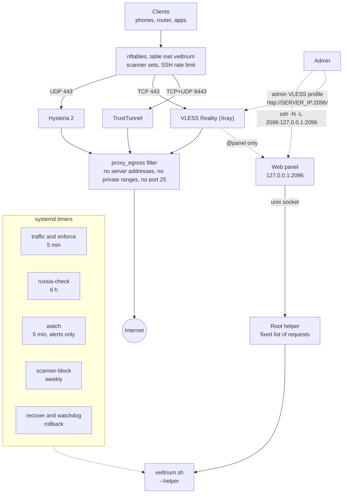

English | [Русский](README.ru.md)

<div align="center">

# Veiltrium

**Secure Multi-Protocol VPN Deployment**

Automated, security-focused deployment of Hysteria2, VLESS Reality and TrustTunnel on Ubuntu VPS.

[](https://github.com/Vanilla-SilQ-HD/Veiltrium/tags)
[](https://github.com/Vanilla-SilQ-HD/Veiltrium/actions/workflows/fast.yml)
[](LICENSE)
[](#supported-systems)

</div>

Veiltrium is a single, self-contained Bash installer (`veiltrium.sh`) that turns a fresh Ubuntu server into a hardened node for three VPN protocols. It uses only the official release binaries of each protocol, pinned by version and SHA-256. No third-party panels, install scripts or `curl | sh` steps are involved. Every change to a working node is checked with a real client and rolled back automatically if it fails. The installer also checks from Russian networks whether the server is reachable at all.

The name: *Veil* (privacy), *Tri* (three protocols), *-ium* (an element, symbol **Vt**).

## Quick start

On the server, as root:

```bash
curl -fsSLO https://raw.githubusercontent.com/Vanilla-SilQ-HD/Veiltrium/main/veiltrium.sh && bash veiltrium.sh
```

Read the script before you run it: it changes the firewall, SSH settings and system updates of the server. The run takes a few minutes and prints the connection details of the first client at the end. Afterwards the short command `veiltrium` is available:

```bash
veiltrium status         # a fast overview of the node
veiltrium add anna       # a new client with its own credentials for all protocols
veiltrium qr anna        # QR codes of the client's links in the terminal
```

## Contents

- [Features](#features)
- [How it compares](#how-it-compares)
- [Architecture](#architecture)
- [Protocols](#protocols)
- [Supported systems](#supported-systems)
- [Using it](#using-it)
- [Phones and apps](#phones-and-apps)
- [Moving to a new server and standby servers](#moving-to-a-new-server-and-standby-servers)
- [Settings](#settings)
- [Security model](#security-model)
- [Reference](#reference)
- [Tests](#tests)
- [Known limitations](#known-limitations)
- [Changelog](#changelog)
- [License](#license)

## Features

**Protocols and TLS identities**

- Hysteria 2, VLESS Reality (Vision) and TrustTunnel from one run; Reality and TrustTunnel can be turned off (`REALITY_ENABLE=0`, `TT_ENABLE=0`).
- Separate TLS identities: each protocol has its own server name and certificate, kept between runs. Changing one never touches the others.
- Measured Reality site selection: candidates are checked directly and with a real Reality client on an isolated loopback instance. The choice comes from a reproducible score, with no random picks and no rotation on re-runs.
- Client apps show the node as `Veiltrium-<country>` (for example `Veiltrium-PL`).

**Security and hardening**

- One non-interactive run as root: system upgrade, automatic security updates, SSH hardening, firewall, fail2ban, kernel tuning, three protocols, end-to-end verification and client links.
- Each proxy runs as its own system user in a systemd sandbox and cannot reach the server itself, private networks or SMTP.
- nftables table `inet veiltrium`: only SSH and the proxy ports are open; scanner networks (refreshed weekly) never see the proxy ports.
- Secrets stay in root-only files; connection details never enter the install log.

**Reliability**

- Transactional changes with automatic rollback: backup, pending marker, real-client check, commit. Errors, Ctrl+C, SIGTERM, SIGKILL and power loss all restore the previous settings without a manual step.
- Idempotent re-runs: a plain re-run keeps passwords, keys, certificates, links and configs byte for byte, restarts no service, drops no connection and does not reboot a working node.
- `--diagnose` and `--dry-run` change nothing; a JSON report without secrets lives in `/var/lib/veiltrium/report.json`.

**Censorship awareness**

- A server name on the block list of Roskomnadzor (RKN) is never chosen for Reality, Hysteria 2 or TrustTunnel.
- [Globalping](https://globalping.io) probes in Russian networks (MTS, Rostelecom and others) check that the server's address answers: at install time, on request, and automatically every 6 hours.
- TSPU stall detection: the optional router probe reports `stalled` when a tunnel connects but the transfer freezes after 16-20 KB (the cut-off of TSPU, the DPI equipment of Russian providers).
- Standby servers: up to 3 more addresses in every link and config, so phones and the router switch by themselves if one address is blocked.
- Export and import move a node with all its secrets to a new VPS; clients change only the address.

**Clients**

- `main` plus any number of added clients, each with its own Hysteria user and password, VLESS UUID and TrustTunnel login and password; revoke or reset one without touching the others.
- Per-client traffic limit, expiry date, periodic reset and a manual disable switch, enforced by a timer.
- Traffic counters per client and protocol, with no extra software in the data path.
- For phones: a base64 subscription and a complete sing-box profile for every client, plus terminal QR codes.

**Operations**

- A short command, `veiltrium`, on the server.
- Alerts to a Telegram bot or a webhook (a service down, no reach from Russia, a rollback).
- An audit log of every change, `--update` and `--check-update`, and a safe `--uninstall`.
- A web panel in English and Russian: overview, clients, limits, traffic, links, QR codes, check from Russia.

## How it compares

How Veiltrium compares with typical one-click VPN install scripts (generic; no project is named).

| | Typical one-click script | Veiltrium |
|---|---|---|
| Binaries | latest release or a third-party panel, often via `curl \| sh` | official Hysteria and Xray releases pinned by version and SHA-256; the TrustTunnel endpoint is pinned the same way |
| Changing a working node | edits in place, a failure leaves a half-configured server | transaction with a real-client check; automatic rollback on error, signal or power loss |
| Re-running | often regenerates secrets or restarts services | keeps secrets and configs byte for byte, no restarts, no reboot |
| Service isolation | proxies run as root | own user per proxy, systemd sandbox, egress filter against the server itself, private ranges and port 25 |
| Admin interface | a public port with a panel | none open: panel on `127.0.0.1`, reached through an SSH tunnel or a separate admin VLESS profile, actions through a root helper with a fixed list of requests |
| Self-signed TLS | `insecure=true` in the link | certificate pinning in links and sing-box JSON |
| Reachability from Russia | not checked | RKN list filter, Globalping check at install and every 6 hours, optional probe from a home router |
| Moving a node | reinstall and re-issue every link | encrypted export and import, only the address changes |
| Tests | none or a syntax check | FAST checks on every push; FULL end-to-end suite with real clients on Ubuntu 26.04 and 24.04 |

## Architecture



## Protocols

| Protocol | Default port | TLS identity | Clients verify the server by |
|---|---|---|---|
| Hysteria 2 (`v2.13.0`) | 443/UDP (QUIC) | own self-signed certificate (EC P-256) | certificate pin: `pinSHA256` in links, `certificate_public_key_sha256` in sing-box |
| VLESS + Reality + Vision (Xray `v26.3.27`) | 443/TCP | a real third-party HTTPS site (Reality `target`/`serverNames`) | the Reality public key, UUID and shortId |
| TrustTunnel (endpoint `v1.1.0`) | 8443/TCP+UDP (HTTP/2 and HTTP/3) | own self-signed certificate, embedded in the `tt://` link | the embedded certificate as the only trust anchor |

Xray is intentionally pinned to `v26.3.27`. From `26.9.8` on, the Reality server rejects a ClientHello without an X25519MLKEM768 key share, which sing-box clients do not send by default.

## Supported systems

- Ubuntu **26.04** (primary target) and **24.04** (also covered by CI).
- amd64 and arm64.
- systemd, nftables and OpenSSH, as shipped with Ubuntu.

## Using it

The installer writes the short command `/usr/local/bin/veiltrium`, which runs the installed copy of the script. Any installer option works too, for example `veiltrium --dry-run`; `veiltrium help` lists all modes and settings.

| Short command | Full form | What it does |
|---|---|---|
| `veiltrium status` | `--status` | fast overview, no tests, no secrets (`--json -` for JSON) |
| `veiltrium clients` | `--list-clients` | the clients of the node |
| `veiltrium add NAME` | `--add-client NAME` | a new client; prints details, saves `/root/veiltrium/clients/NAME.txt` |
| `veiltrium remove NAME` | `--remove-client NAME` | revoke a client |
| `veiltrium show NAME` | `--show-client NAME` | connection details of a client |
| `veiltrium qr NAME` | `--qr NAME` | terminal QR codes of the client's links |
| `veiltrium reset NAME` | `--reset-client NAME` | new credentials, same name |
| `veiltrium limit NAME ...`, `disable NAME`, `enable NAME` | `--set-client`, `--disable-client`, `--enable-client` | limit, expiry, periodic reset, switch off and on |
| `veiltrium traffic` | `--traffic` | traffic per client |
| `veiltrium russia` | `--check-russia` | do Russian networks reach this server? |
| `veiltrium diagnose` | `--diagnose` | check the node, change nothing |
| `veiltrium audit [N]` | `--audit [N]` | the last N lines of the audit log |
| `veiltrium export FILE` | `--export FILE` | pack the node, encrypted |
| `veiltrium test-alert` | `--test-alert` | test message to the alert channels |
| `veiltrium check-update`, `update` | `--check-update`, `--update` | look for a newer release, install it |
| `veiltrium panel-password` | `--panel-password` | new web panel password |
| `veiltrium uninstall` | `--uninstall` | remove Veiltrium |
| `veiltrium install` | (no option) | the same as re-running the installer |

Options without a short form: `--reselect-reality`, `--dry-run`, `--trial-reality`, `--trial-minutes`, `--trial-stop`, `--enforce`, `--traffic-reset`, `--import`, `--import-mts`.

**Web panel.** Every node gets a small panel on `127.0.0.1:2096`. Open the tunnel and browse to `http://localhost:2096/`:

```bash
ssh -N -L 2096:127.0.0.1:2096 root@SERVER_IP
```

Or without SSH: import the admin VLESS profile from `/root/veiltrium/panel.txt` into a VPN app, connect with it and open `http://SERVER_IP:2096/`.

The password is printed at the end of the install and kept in `/root/veiltrium/panel.txt`. The details are in the web panel entry of the [reference](#reference) below.

## Phones and apps

Every client gets two extra files next to its details (`/root/veiltrium/client.*` for `main`, `/root/veiltrium/clients/NAME.*` for the others; root only; a disabled client has none). They are also in `--show-client NAME --json -` as `subscription_base64` and `singbox_profile`, and the panel offers them in its import section.

| File | What it is | For |
|---|---|---|
| `.singbox.json` | a complete sing-box profile: TUN inbound, DNS over HTTPS through the proxy, Hysteria 2 and VLESS Reality outbounds, standby servers, a `urltest` group `auto` and a selector `proxy`. The Hysteria certificate pin is checked. Needs sing-box 1.12 or newer | apps built on sing-box: Hiddify, NekoBox, Karing, sing-box SFA/SFI |
| `.sub` | a base64 subscription: the Hysteria 2 and VLESS links, standby ones included, no TrustTunnel. `--qr NAME` also prints it as a QR code when it fits | apps built on Xray: v2rayNG, v2rayN, Happ. Hysteria 2 support and its pin vary by app there: prefer VLESS Reality |

- If the connection degrades after a few minutes in VPN (TUN) mode on a phone, try the app's proxy mode or turn off sniffing.
- For Reality keep `fp=chrome`, do not enable TCP Fast Open, do not use `fp=random`.
- Copy links without passing them through chat apps or Markdown renderers, which break `&` and `_`.

<details>
<summary>AWG Manager and sing-box compatibility</summary>

- **Hysteria 2.** AWG Manager deliberately drops `pinSHA256` from `hysteria2://` links and imports them with `insecure=true`, i.e. **without any certificate check**. Instead, use section 6 of `/root/veiltrium/client.txt`: a sing-box JSON block with `certificate_public_key_sha256`, imported as a server group (sing-box JSON). The router's sing-box build (`1.15.0-alpha.12-awgm.33`) enforces the pin, including over QUIC; CI checks this with the same build. `keenetic-vpn-probe.sh --check-awg` shows whether the router's config actually pins the key.
- **VLESS Reality.** The `vless://` link imports as is (`fp=chrome`, `flow=xtls-rprx-vision`).
- **TrustTunnel.** The `tt://` link carries the certificate. AWG Manager verifies it, but uses HTTP/2 only.
- **Other sing-box clients.** Use the JSON outbounds from the client file. `certificate_public_key_sha256` is the base64 SHA-256 of the public key (SPKI), which is not the same value as Hysteria's hex `pinSHA256`.

</details>

## Moving to a new server and standby servers

If the address of a server gets blocked, move the node with all its secrets: every client keeps working after changing only the server address in its link.

```bash
bash veiltrium.sh --export /root/node.vt        # old server; asks for a passphrase (12+ characters)
scp /root/node.vt root@NEW_IP:/root/
bash veiltrium.sh --import /root/node.vt        # new server; a normal install that starts from the export
```

To switch clients automatically instead, deploy the second VPS from an export and set `STANDBY_HOSTS=<its IPv4>` on the first server, then re-run it. Every link and config then also lists the standby server.

<details>
<summary>Export, import and standby details</summary>

- The export holds the Hysteria, Reality and TrustTunnel keys, passwords and certificates, the server names, the added clients and the probe key. It is a tar of a fixed list of files encrypted with `openssl enc -aes-256-cbc -pbkdf2 -iter 600000 -md sha256` (the file is plain openssl output, mode 600, never overwritten). Anyone with the file and the passphrase owns the node: keep them apart and delete the file afterwards.
- Without a terminal give the passphrase in `VT_EXPORT_PASSPHRASE` / `VT_IMPORT_PASSPHRASE` (the script removes it from its environment at once).
- The import checks the file name by name (regular files from the fixed list only, sizes, SHA-256 manifest, the exact format of every state file, certificate and key pairs) before it places anything. It runs only on a server with no node, or with the same node (a standby copy being refreshed); a different node is refused.
- The new server gets a new web panel password and detects its country name again. Ports of the old node are kept unless you set `REALITY_PORT` / `TT_PORT` yourself.
- `STANDBY_HOSTS` takes up to 3 public IPv4 addresses, comma-separated, saved; `none` clears. The standby servers must be copies of this node using the same ports. Links (hysteria2, vless, tt), sing-box outbounds with a `urltest` group and the AWG Manager server group all list them. Export again after adding or removing clients.

</details>

### Connection health and device setup

The web overview separates service status, Globalping address reachability and actual home-network tunnel transfers. Every result has a timestamp. Address evidence expires after 12 hours; home probes after `MTS_MAX_AGE_DAYS` (14 days by default). A TCP reply is not proof of a working VPN, and a missing reply alone does not prove a block. The overview suggests diagnostics, another address check, a router probe or device setup.

The client card offers a four-step guide: device → app and format → import → browsing and a transfer larger than 1 MB. Android, iPhone/iPad, Windows and Keenetic/AWG Manager are covered. Full JSON is for apps that explicitly import complete sing-box configurations; using the sing-box core alone does not guarantee this. Existing links and QR codes remain in expandable advanced details. Final checkboxes record the user's confirmation in this tab, not measurements by the panel.

### Checking standby state

On the standby server run:

```bash
veiltrium standby-receipt
```

Paste the full `vt-standby-1|…` line into the primary panel: Overview → Standby state → Check / instructions. Terminal equivalent:

```bash
veiltrium verify-standby 'vt-standby-1|…'
veiltrium standby-status
```

Both servers need a script version that supports these commands. The standby must come from the same node export with the shared probe key, and its address must appear in the primary's `STANDBY_HOSTS`. A receipt contains no credentials: HMAC with the shared key authenticates both its snapshot and its fingerprint. It is a statement by a holder of that key, not independent server attestation.

The comparison covers main and added client credentials, restrictions and states, certificates, protocol server names and ports. Local addresses, node labels, panel admin accounts, statistics ports and traffic counters may differ. A match means only **the saved configuration matched at the snapshot time**. It lasts 24 hours; the remote node may change afterwards. It does not verify reachability, the process's applied configuration or tunnel operation. Local changes are detected on the next overview refresh. Invalid signatures, unconfigured addresses, expired or future snapshots are rejected; older receipts cannot replace newer ones.

Disable, revoke, credential reset and restrictions apply only to the local server. Old credentials may keep working on a standby. The panel warns before these changes. Export the primary to a new encrypted archive, copy it to the standby and run `bash veiltrium.sh --import /root/node-backup.enc` there; then generate and verify a new receipt. Exports with changed main-client shared credentials may require a clean target under the existing import identity rules. Reimport device profiles after port or server-name changes.

Traffic quotas are **per server**, without a shared counter or automatic synchronization. Timers may independently disable a client for quota or expiry; that also changes the compared state.

## Settings

Optional settings are environment variables written before the command: `VAR=value bash veiltrium.sh`. Most are saved, so later runs keep them.

<details>
<summary>All settings</summary>

| Variable | Default | Meaning |
|---|---|---|
| `REALITY_CANDIDATES` (old name `MASK_SITES`) | built-in list of 10 sites | Reality candidates; saved; `default` restores the built-in list |
| `REALITY_SNI` | – | use exactly this Reality site (checked first) |
| `HY2_SNI` | chosen separately | Hysteria SNI and certificate name; saved; `auto` picks a new independent name |
| `TT_SNI` | chosen separately | TrustTunnel hostname and certificate name; saved; `auto` as above |
| `HY2_MASQUERADE_URL` | `auto` (`https://<Hysteria SNI>`) | page served to HTTP/3 probers; saved |
| `REALITY_ENABLE`, `TT_ENABLE` | `1` | `0` turns VLESS Reality or TrustTunnel off |
| `HY2_PORT` | `443` | Hysteria UDP port; an existing node keeps its port |
| `REALITY_PORT`, `TT_PORT` | `443`, `8443` | Reality TCP port, TrustTunnel TCP+UDP port; an existing node keeps its ports unless they are given explicitly |
| `REALITY_FP` | `chrome` | TLS client fingerprint in the VLESS link |
| `PUBLIC_IP` | detected | server address for the links (behind NAT) |
| `PANEL_ENABLE`, `PANEL_PORT` | `1`, `2096` | `0` turns the web panel off; the panel's port on `127.0.0.1` (saved) |
| `PANEL_VPN` | `1` | `0`: the panel through the SSH tunnel only, no admin VLESS profile (saved) |
| `GLOBALPING` | `1` | `0` turns off the check from Russian networks (it sends the server's address to Globalping); saved |
| `RU_BLOCKLISTS` | itdoginfo `Categories/block.lst` | URLs of RKN block lists (domains, one per line) |
| `NODE_NAME` | the server's country | node name in client apps, `Veiltrium-<NODE_NAME>`; saved; `auto` detects the country again, `none` gives just `Veiltrium` |
| `STANDBY_HOSTS` | none | up to 3 standby server addresses; saved; `none` clears (see above) |
| `SCANNER_BLOCK` | `1` | `0` turns the scanner blocklist off |
| `ALERT_TG_TOKEN`, `ALERT_TG_CHAT`, `ALERT_WEBHOOK` | none | alert channels; saved; `none` clears (see Alerts) |
| `VT_AUTO_REBOOT`, `AUTO_REBOOT_TIME` | `1`, `01:30` | a **new** node reboots right away if updates need it; nightly reboot time |
| `VT_RECONFIGURE` | `0` | `1` issues new passwords, keys and certificates, for the added clients too (all clients must be updated) |
| `VT_YES` | – | `1` answers the `--update` question; `uninstall` answers the `--uninstall` question |
| `MTS_MAX_AGE_DAYS` | `14` | home-network probe results older than this are ignored |

`HY2_RECONFIGURE` and `HY2_AUTO_REBOOT` still work as old names of `VT_RECONFIGURE` and `VT_AUTO_REBOOT`.

</details>

## Security model

- **Firewall (nftables, own table `inet veiltrium`).** Only SSH and the proxy ports are reachable from outside. SSH is rate-limited. Scanner networks from public lists (refreshed weekly) see only SSH, never the proxy ports. Other tables (for example fail2ban) are left alone.
- **Egress isolation.** The proxy users may not connect to the server's own addresses, private ranges or port 25.
- **SSH.** Hardened (`MaxAuthTries`, `LoginGraceTime`, `MaxStartups`, verbose logging) **without** disabling password or root login. This is by design; brute force is handled by nftables limits, fail2ban and OpenSSH `PerSourcePenalties`.
- **Updates.** Unattended security upgrades with a nightly reboot window. `needrestart` is told never to restart the proxies, so a library update does not drop clients.
- **Secrets.** Root-only state files (`0600`). Connection details are printed to the terminal and saved to `/root/veiltrium/client.txt`, never into the install log. Reports and probe results contain no secrets.
- **Crash safety.** A change is a transaction: backup, pending marker, real client check, then commit. Rollback happens through the EXIT trap (errors, Ctrl+C, SIGTERM), a systemd watchdog timer (SIGKILL or a hung run), and `veiltrium-recover.service` at boot (power loss).

<details>
<summary>Self-signed certificates: what they do and do not give you</summary>

Without a domain, Hysteria 2 and TrustTunnel use self-signed certificates.

- **They are secure only when the client really checks them.** A Hysteria client must pin the certificate (`pinSHA256`, or `certificate_public_key_sha256` in sing-box). A TrustTunnel client must trust only the embedded certificate.
- **A client that sets `insecure=true` without a pin accepts any certificate.** An interceptor can then read the password.
- **A self-signed certificate never looks like the real site it is named after.** An active prober can tell. Only VLESS Reality shows a prober the genuine certificate of a real site. The Hysteria HTTP/3 masquerade page is served behind the self-signed certificate.
- Hysteria's built-in ACME cannot obtain IP-address certificates (no ACME profile support), and its challenges need port 80 or TCP 443, which Reality uses. So self-signed with pinning is the only supported mode.

</details>

## Reference

Longer reference material; every topic is collapsed below.

<details>
<summary>Installing on a fresh VPS</summary>

On the server, as root:

```bash
curl -fsSLO https://raw.githubusercontent.com/Vanilla-SilQ-HD/Veiltrium/main/veiltrium.sh
bash veiltrium.sh
```

Or copy it from your computer:

```bash
git clone https://github.com/Vanilla-SilQ-HD/Veiltrium.git
scp Veiltrium/veiltrium.sh root@SERVER_IP:/root/
ssh root@SERVER_IP "bash /root/veiltrium.sh"
```

At the end the run prints, and saves to `/root/veiltrium/client.txt` (root only):

- a `hysteria2://` link and a sing-box outbound with key pinning;
- a `vless://` link and a sing-box outbound;
- a `tt://` link;
- a sing-box JSON block for AWG Manager (section 6).

For example, to copy a link from PowerShell:

```powershell
ssh root@SERVER_IP "grep -m1 '^vless://' /root/veiltrium/client.txt" | Set-Clipboard
```

</details>

<details>
<summary>Re-running the installer and migrating from hy2-secure-install</summary>

Re-run the same command to update or repair a node:

```bash
ssh root@SERVER_IP "bash /root/veiltrium.sh"
```

A plain re-run:

- keeps every password, key, UUID, shortId, certificate, server name and link;
- rewrites configs only with identical content, so no service restarts and active connections stay up;
- never reboots a working node (it reports a pending reboot; the nightly window applies);
- restores the settings of any interrupted earlier change first.

**Nodes installed by `hy2-secure-install.sh`** (the project's earlier name, up to `v2026.10.13.1`) move to the Veiltrium names on their first run of `veiltrium.sh`:

- `/etc/hy2-secure` to `/etc/veiltrium`, `/var/lib/hy2-secure` to `/var/lib/veiltrium`;
- root's files to `/root/veiltrium/` (`client.txt`, `clients/`, `probe.env`, `panel.txt`);
- the firewall table `inet hy2fw` to `inet veiltrium`, the helper units and drop-ins (`veiltrium-scanner-block`, `veiltrium-recover`, sysctl, SSH, fail2ban, needrestart, apt) to their `veiltrium` names;
- keys, passwords, certificates, clients and links stay as they are; the three proxy services restart once (the comments in their configs change), so connected clients reconnect within seconds;
- the old files are removed at the end of the run. Results of an older `keenetic-vpn-probe.sh` are still accepted.

Maintenance modes take the installer's lock and wait up to 90 seconds for it. `--diagnose` and `--dry-run` change nothing on the server.

```bash
bash /root/veiltrium.sh --diagnose            # check the node, change nothing
bash /root/veiltrium.sh --diagnose --json /root/diag.json
bash /root/veiltrium.sh --dry-run             # what --reselect-reality would choose, change nothing
bash /root/veiltrium.sh --check-russia        # do Russian networks reach this server? (Globalping)
bash /root/veiltrium.sh --help
```

</details>

<details>
<summary>Clients, reset, limits and expiry</summary>

The first client, `main`, is created by the installer (`/root/veiltrium/client.txt`). More clients get their own credentials for all three protocols: a Hysteria user and password, a VLESS UUID, and a TrustTunnel login and password. Revoking one never affects the others.

```bash
bash /root/veiltrium.sh --add-client anna      # prints the details, saves /root/veiltrium/clients/anna.txt
bash /root/veiltrium.sh --list-clients
bash /root/veiltrium.sh --show-client anna
bash /root/veiltrium.sh --remove-client anna
bash /root/veiltrium.sh --reset-client anna    # new credentials, same name
```

- Names: 1-32 characters, `a-z`, `0-9`, `_` and `-`, starting with a letter or digit; `main` is the first client.
- Adding or removing a client rewrites the three server configs as one change and restarts the services: connected clients reconnect within a few seconds. Real clients then check that the main client and the new one work, or that a removed one no longer does. Otherwise the previous settings come back.
- Hysteria uses a password per client (`user:password`). A node installed before this version has one shared password. Its first `--add-client` switches it, so the main client's Hysteria link and JSON change once; its VLESS and TrustTunnel links stay the same.
- A plain re-run keeps every client and their links. If a server name or certificate changes, their detail files are rewritten with the new links.
- `veiltrium qr NAME` writes to the terminal only, because the links hold secrets.

**Resetting credentials.** `--reset-client NAME` gives an added client a new VLESS UUID, a new Hysteria password and a new TrustTunnel password under the same name, for example after a phone was lost. It runs the same transaction as adding or removing a client: the three server configs change together, the services restart, and real clients check that the new credentials work, the old Hysteria and VLESS ones no longer do, and the main client still works. Otherwise the previous settings come back. The details in `/root/veiltrium/clients/NAME.txt` are rewritten and printed; send them to the client. `main` cannot be reset this way: `VT_RECONFIGURE=1 bash veiltrium.sh` replaces the secrets of the whole node, the added clients included.

**Limits and expiry.** An added client (never `main`) can have a traffic limit, an expiry date and a periodic reset, and can be switched off without being deleted.

```bash
bash veiltrium.sh --set-client anna --limit 50G --expires 2027-01-31 --reset monthly
bash veiltrium.sh --set-client anna --limit none --expires none --reset none
bash veiltrium.sh --disable-client anna        # its credentials stop working; the client stays
bash veiltrium.sh --enable-client anna
bash veiltrium.sh --enforce                    # apply limits and expiry now
veiltrium limit anna --limit 50G               # the short command: limit, disable, enable
```

- `--limit SIZE|none`: plain bytes or a number with `K`, `M`, `G` or `T`; decimal units (`1G` = 10^9 bytes); at most 10^15. What counts is upload plus download of all three protocols in the current period.
- `--expires YYYY-MM-DD|none`: a real calendar date (UTC); the client works through the end of that day.
- `--reset none|daily|weekly|monthly`: when the usage starts again from zero (UTC: every day, every Monday, the 1st of the month). With `none` the usage is counted from the moment a limit is set.
- A client that is disabled is left out of the Xray, Hysteria and TrustTunnel configs; its details file in `/root/veiltrium/clients/` stays with a `DISABLED (reason)` line at the top. The reason is `manual`, `quota` or `expired`. `--list-clients` shows state, limit, expiry and reset; the JSON of `--list-clients` and `--show-client` has `state`, `reason`, `limit`, `expires`, `reset`, `period_start` and `period_bytes`.
- The traffic timer (every 5 minutes) reads the counters and, only when some client must change, runs `--enforce`: it stops clients that reached their quota or expired, and brings back clients that were stopped by a quota or expiry that no longer applies (a new period, a higher limit, a later date). All changes of one run are one change: configs, restart, then real clients check that the main client works, every client that should work does, and every stopped client no longer connects; otherwise the previous settings come back (the timer then waits an hour before trying again). A manual `--disable-client` is never lifted by the timer; `--enable-client` refuses while the quota is used up or the date has passed and tells you what to change. Nothing runs during a Reality trial or an interrupted change.
- Each state change is written to the audit log (`client-disabled`, `client-enabled`) and sent to the alert channels, for example `client anna disabled: quota 50 GB reached`. Changing only the settings of a client that stays in its state restarts nothing.

</details>

<details>
<summary>Traffic counters</summary>

The installer counts the traffic of every client, per protocol: bytes up (from the client), bytes down (to it) and when it was last seen.

```bash
bash /root/veiltrium.sh --traffic            # a table; --json - for JSON
bash /root/veiltrium.sh --traffic-reset      # all counters to zero
```

- The proxies count themselves; nothing sits in the data path. Hysteria (`trafficStats`), Xray (`StatsService`) and TrustTunnel (`per_client_metrics`) each expose a statistics endpoint on `127.0.0.1` only, with a port of its own (Hysteria also a secret), saved in the protocol's state file. The firewall keeps the proxies away from the server's own addresses, so clients cannot reach these endpoints through the tunnel.
- `veiltrium-traffic.timer` reads them every 5 minutes and right before any restart of a service (a restart resets the proxies' own counters), and adds the numbers to `/var/lib/veiltrium/traffic.json` (root only): totals per client and protocol, and per day for the last 90 days. No secrets and no client addresses are stored there. A client that is removed takes its counters with it.
- The clients' JSON (`--list-clients`, `--show-client` with `--json -`) carries `traffic` per client, and `--status` the totals.
- A node installed before this feature gets the endpoints on its next run of the installer: Hysteria, Xray and TrustTunnel restart once for that, then re-runs change nothing again. Traffic before that run is not counted.
- Not counted: what moved between the last reading and a crash or a reboot (at most 5 minutes).

</details>

<details>
<summary>Web panel</summary>

Every node gets a small web panel: an overview of the node and its protocols, and the clients with their links, QR codes and the AWG Manager JSON; clients can be added, revoked, reset, limited and disabled there. The interface is available in English and Russian.

```bash
ssh -N -L 2096:127.0.0.1:2096 root@SERVER_IP     # keep it open, then browse to http://localhost:2096/
```

- The password is printed at the end of the install and kept in `/root/veiltrium/panel.txt` (root only). `bash /root/veiltrium.sh --panel-password` sets a new one and signs everybody out.
- **Nothing new is open on the internet.** The panel listens on `127.0.0.1` only. The proxies cannot reach it (the firewall keeps them off the server's own addresses), and the panel itself has no internet access (systemd `IPAddressDeny`).
- **Two ways in.** The SSH tunnel above, or, by default (`PANEL_VPN=1`), a separate VLESS Reality profile only for the admin: it is in `/root/veiltrium/panel.txt`, not in any client's files. Connect with it in a VPN app and open `http://SERVER_IP:2096/`; the password is still asked. Xray sends that profile's TCP connections to the panel's port (to whatever address) to the panel, from the source address `127.0.0.2`; the firewall lets Xray reach `127.0.0.1:2096` from that address only. So no client profile, no other protocol and nobody on the internet gets to the panel, and no new port is open. The profile works as a normal VPN profile too. Open that address only while the profile is connected: without it the browser goes to the server's address over the open network in plain HTTP, and anyone on the way could answer with a fake page (the SSH tunnel has no such case: `localhost` never leaves the computer). `PANEL_VPN=0` removes the profile (saved); turning it on again gives a new one.
- **No privileges in the web process.** `veiltrium-panel` (Go, one static binary with the interface embedded) runs as its own user in a systemd sandbox. Every action goes over a unix socket, open only to that user's group, to a root helper that systemd starts per request: this installer in `--helper` mode, which accepts a fixed list of requests (status, list, show, add, remove, reset, set, disable, enable, audit, check-russia) with checked names and runs the same tested code as the command line.
- Web rules: a session cookie (`HttpOnly`, `SameSite=Strict`), a custom header and same-origin check on every change, only `localhost` and the server's own IP address as host names (no DNS rebinding), a strict Content Security Policy with no external resources. After 5 failed logins every further failure pauses all logins: 1, 2, 4 minutes and so on, up to an hour; the pause stays at an hour; a successful login or a day without failures starts the count again.
- The binary comes from this repository's releases (`panel-v*`), SHA-256 pinned in the installer like the proxies. `PANEL_ENABLE=0` leaves it out.
- The command line has the same machine interface: `--status`, `--list-clients`, `--show-client NAME`, `--add-client NAME`, `--remove-client NAME`, `--check-russia`, `--diagnose` and `--dry-run` take `--json -`.

</details>

<details>
<summary>Alerts</summary>

Off by default. With a channel set, the server tells you when something breaks; it only sends out, nothing listens.

```bash
ALERT_TG_TOKEN=123456789:AAH... ALERT_TG_CHAT=123456789 bash veiltrium.sh   # Telegram bot (from @BotFather) and the chat id
ALERT_WEBHOOK=https://example.com/hook bash veiltrium.sh                     # or a webhook: JSON POST {node, server, event, text, time}
bash veiltrium.sh --test-alert                                               # a test message; reports per channel
ALERT_TG_TOKEN=none ALERT_WEBHOOK=none bash veiltrium.sh                     # turn off
```

- Settings are validated strictly, saved in `/etc/veiltrium/alerts.env` (root only, 600) and kept on later runs. The token is never printed back (only `123456789:****`) and not written to the install log. It reaches `curl` through its config on stdin, so it is not on any command line. Note that a variable typed in the shell stays in your shell history.
- Events, each sent once per change: a proxy service not active in 2 checks in a row (`veiltrium-watch.timer`, every 5 minutes, exists only while a channel is set) and again when it recovers; the check from Russia reaching `bad_streak` 2 (with the hint to move to a new server or use a standby address) and again when it is reachable; a rollback (an install run or a client change that did not pass its checks and was restored).
- A failed delivery goes to the journal (`journalctl -t veiltrium-alert`) and never stops anything. The messages hold the node name, the server address and a short hint; no secrets.

</details>

<details>
<summary>Updates</summary>

```bash
bash veiltrium.sh --check-update      # is a newer release out? (--json - for JSON); no changes
bash veiltrium.sh --update            # download it, check it, ask, then run it as a normal install
```

- `--check-update` reads the release feed of this repository (installer tags `vYYYY.MM.DD[.N]` only; panel tags are ignored) and compares it numerically with the installed version.
- `--update` downloads `veiltrium.sh` of that tag from `raw.githubusercontent.com` into a private file, checks that it is a bash script of exactly that version (`SCRIPT_VERSION` equal to the tag, complete, `bash -n`), shows `current -> new` and asks you to type `yes` (`VT_YES=1` skips the question). It replaces nothing itself: it runs the new script as an ordinary install with your environment, which refreshes the installed copy as usual (keys, passwords and clients are kept).
- Trust is the same as for the `curl` one-liner: GitHub and HTTPS. There is no signature yet.

</details>

<details>
<summary>Audit log</summary>

Every action that changes the node adds one line to `/var/log/veiltrium/audit.log` (directory `750`, file `640`, root only; logrotate keeps six monthly files): time (UTC), source (`cli`, or `panel` for the web panel), action (`install`, `import`, `export`, `add-client`, `remove-client`, `reset-client`, `set-client`, `disable-client`, `enable-client`, `enforce`, `client-disabled`, `client-enabled`, `panel-password`, `traffic-reset`, `uninstall`), target (a client name or a file name) and the result (`ok`, `rolled-back` or `failed`). No secret is ever written.

```
2026-10-20T09:14:02Z source=panel action=add-client target=anna result=ok
```

```bash
bash /root/veiltrium.sh --audit          # the last 50 lines
bash /root/veiltrium.sh --audit 200
bash /root/veiltrium.sh --audit --json - # a JSON array
```

</details>

<details>
<summary>Uninstalling</summary>

```bash
bash /root/veiltrium.sh --uninstall      # asks you to type "uninstall"; VT_YES=uninstall answers it without a terminal
```

It lists what it will remove and waits for the word. It then stops and removes the three proxy services, the panel and its helper, every `veiltrium-*` unit and timer, the programs it installed (`hysteria`, `xray`, `trusttunnel_endpoint`, `veiltrium-panel`, `veiltrium-recover`, `veiltrium-scanner-block`), the settings and state (`/etc/hysteria`, `/usr/local/etc/xray`, `/etc/trusttunnel`, `/etc/veiltrium`, `/etc/veiltrium-panel`, `/var/lib/veiltrium`, `/usr/local/lib/veiltrium`), the install log, the needrestart override, the firewall table `inet veiltrium`, its lines in `/etc/nftables.conf` (the file is edited and checked with `nft -c` first; the other lines stay, and if nothing else was in it, the original saved at install time comes back) and the four service users. **`/root/veiltrium` goes too**: it holds the client details, the probe profile and the panel password. After the uninstall everything but SSH is reachable again unless another firewall is in place.

It never touches what protects the server by itself: the SSH settings (`/etc/ssh/sshd_config.d/00-veiltrium-hardening.conf`), fail2ban (`/etc/fail2ban/jail.d/veiltrium-sshd.local`), automatic updates (`/etc/apt/apt.conf.d/52veiltrium-unattended-upgrades`, `20auto-upgrades`), journald (`/etc/systemd/journald.conf.d/50-veiltrium.conf`) and the kernel hardening (`/etc/sysctl.d/99-zz-veiltrium-hardening.conf`, `/etc/modules-load.d/veiltrium-bbr.conf`); nor the packages, nor the audit log. The last lines of the output name the ones that still exist so you can remove them by hand. A second run reports that there is nothing to remove.

</details>

<details>
<summary>Managing the Reality SNI</summary>

The Reality site is chosen on a new node, and only changes when you ask for it:

```bash
bash /root/veiltrium.sh --dry-run             # see the scores first
bash /root/veiltrium.sh --reselect-reality    # re-evaluate and switch if clearly better
REALITY_SNI=www.example.com bash /root/veiltrium.sh --reselect-reality
```

**How a site is evaluated.**

- Direct checks:
  - DNS gives only public IPv4 addresses;
  - on every address (up to 4): TLS 1.3 with X25519, ALPN h2 and a certificate valid for the name;
  - at least 2 of 3 HTTPS handshakes over h2 succeed.
- Then a throwaway Reality server with the node's own keys runs on loopback, so the live service is not touched, and is tested with a real client:
  - at least 2 of 3 requests through the tunnel succeed;
  - a prober without the key must receive the site's real certificate.

**Score** (lower is better): TLS median + spread + 250 × TLS failures + Reality median + 250 × Reality failures, −200 for a verified home-network success, +600 for a verified home-network failure. Ties keep the list order. The current site stays unless another one is better by more than max(50, 25 %).

**On a switch, only the `sni` / `server_name` of the VLESS link changes.** UUID, keys and shortId stay, and Hysteria and TrustTunnel are not touched. If the new site fails on the live port, the previous config comes back (exit code 2).

**Trial from home.** `--trial-reality` adds extra server names for a limited time through a runtime drop-in and a timer. A reboot also ends it. While it runs, a prober using a trial name sees the production site's certificate, so keep trials short.

```bash
bash /root/veiltrium.sh --trial-reality www.example.com --trial-minutes 30
bash /root/veiltrium.sh --trial-stop
```

</details>

<details>
<summary>What Russia sees: RKN list, Globalping, 6-hour check</summary>

A check from a European server says nothing about a home provider in Russia. The installer therefore checks the following by itself:

- **Server names on the RKN block list.** The list is downloaded at every site choice (`RU_BLOCKLISTS`, by default itdoginfo's curated `Categories/block.lst`: RKN blocks only, without the sites that geoblock Russians themselves, which do not matter for Reality). A candidate on it is never chosen as the Reality site or as a Hysteria / TrustTunnel name; `--diagnose` warns if a name in use is on it.
- **Is the server's address reachable from Russia?** At the end of every install, in `--diagnose`, with `--check-russia` and with the panel's *Check now* button, [Globalping](https://globalping.io) probes in Russian networks (two at MTS, two at Rostelecom, four more anywhere in Russia) ping the address and connect to the Reality and TrustTunnel TCP ports. No answer from any of them means the address is blocked: ask the hoster for another one. The result is kept in `/var/lib/veiltrium/russia.json` and shown in the panel.
- **The check repeats every 6 hours** (`veiltrium-russia-check.timer`, started 20 minutes after boot, with a random delay; output in the journal) while `GLOBALPING` is on. `russia.json` keeps `bad_streak`, the number of checks in a row that were `partly` or `blocked` (a `reachable` check resets it; a check Globalping did not answer changes nothing). From 2 in a row, `--status` warns that the address is not reachable from Russia: consider moving to a new server or switching clients to a standby address.
- The server's address goes to Globalping's public measurement service. `GLOBALPING=0` (saved) turns the automatic check off; `--check-russia` still runs on request.
- Neither check sees whether DPI lets a protocol through: that shows only in a real client (for example, the tunnel's status in AWG Manager).

</details>

<details>
<summary>Optional: a probe from a Keenetic router (TSPU stall detection)</summary>

`tools/keenetic-vpn-probe.sh` tests every protocol with real clients from the home network itself, through the router's physical WAN, and signs the results for the server (`--import-mts`), where a verified success counts in the Reality site score. It is not needed for a working setup.

Home-network status values on the server: `ok`, `fail`, `degraded`, `stalled`, `route_unverified`, `stale` (older than 14 days) and `untested`. `stalled` means the tunnel connects, but transfers freeze after a few KB (the TSPU 16-20 KB cut-off): the probe got only part of the payload download. Such a result is a penalty in the Reality site score, like `degraded`.

The script runs on the router (POSIX sh, BusyBox) and tests each server through the physical WAN. It uses temporary clients with a local SOCKS port only: no TUN, no routes, no firewall changes, and AWG Manager keeps running.

The examples use the Entware SSH server on the router (often port 222); adjust address and port.

1. Each install writes a probe profile `/root/veiltrium/probe.env` (contains passwords; keep it `0600`). Copy it to the router, one file per server:

   ```bash
   ssh root@SERVER_IP "cat /root/veiltrium/probe.env" | ssh -p 222 root@ROUTER "mkdir -p /opt/etc/vpn-probe && cat > /opt/etc/vpn-probe/server1.env && chmod 600 /opt/etc/vpn-probe/server1.env"
   curl -fsSLO https://raw.githubusercontent.com/Vanilla-SilQ-HD/Veiltrium/main/tools/keenetic-vpn-probe.sh
   scp -O -P 222 keenetic-vpn-probe.sh root@ROUTER:/opt/bin/
   ```

2. On the router, install the tools and run the probe. Pass your physical WAN interface; PPPoE is usually `ppp0`.

   ```sh
   opkg update && opkg install tcpdump jq curl
   ip -4 route get SERVER_IP; ip -4 rule show
   sh /opt/bin/keenetic-vpn-probe.sh --all --check-awg --wan ppp0 --output /opt/tmp/vpn-probe.json
   ```

   Options: `--reality`, `--hysteria`, `--trusttunnel`, `--trial-sni a,b`, `--runs N`, `--payload-bytes N`, `--payload-url URL`, `--profile FILE`, `--profile-dir DIR`, `--singbox PATH`, `--tt-client PATH`, `--help`.

3. Import the result on each server:

   ```bash
   ssh -p 222 root@ROUTER "cat /opt/tmp/vpn-probe.json" | ssh root@SERVER_IP "bash /root/veiltrium.sh --import-mts -"
   ```

**What counts as proof.**

- A result counts only with `route: verified`: packets from the test client's own sockets were seen leaving through the physical WAN (tcpdump, with conntrack for NAT).
- Anything else is `route_unverified` and does not count. That includes a VPN interface given as the WAN, a local redirect, or missing evidence.
- A single success does not prove that DPI is bypassed.

**Signatures.**

- Results are signed with HMAC-SHA256 using the server's probe key.
- Each server's lines are bound by a signed header (count and hash) and a run id. Changed, dropped, foreign, old or replayed results are rejected.
- A signature proves which profile produced a result, not where the probe ran. That is what the route evidence is for.

</details>

## Tests

Three levels:

| Change | Checks |
| --- | --- |
| Documentation, translations, web interface | **FAST**: syntax, shellcheck, unit/UI tests and one panel build |
| Panel API/helper, client operations, CI/test configuration | **INTEGRATION**: installed Ubuntu 24.04 node, real clients of all three protocols, panel authentication/CSRF/permissions, client changes, standby state and device bundles |
| `veiltrium.sh`, Keenetic probe, release binary packaging | **FULL**: both OS versions, failure/recovery scenarios and legacy upgrade |

- FAST (`fast.yml`) runs on PR updates and pushes to `main`. Work-branch pushes and tags do not duplicate the PR run; `tests/fast.sh` builds/tests the panel once.
- `integration.yml` selects checks from the complete PR diff, including deletions and renames. Unknown code paths require FULL. An installer-change draft runs INTEGRATION; marking it Ready for review starts FULL. Updating a ready PR cancels the obsolete run and checks the new revision.
- INTEGRATION reuses the FULL tests without lengthy Reality selection, destructive recovery cases, reboot simulation or export/reinstall. Its timeout is 25 minutes; actual time depends on installation and network access. FAST separately covers unit tests and the build. If a change alters a FULL-only test scenario, run FULL manually to validate that scenario; CI plumbing changes alone do not launch it automatically.
- A ready PR that changes the installer version or panel pins automatically runs FULL with `release_panel=true`. The published tag must contain the same panel source. Prepare the final version/pins before marking the PR ready; reuse that successful run for the release instead of dispatching another FULL.
- FULL (`e2e.yml`, typically 45–55 minutes) is required before an installer release, on the final version with pinned binaries. It does not automatically repeat on merge or a tag. A result may be reused after merging when the file tree is identical. For a release:

  ```bash
  gh workflow run e2e.yml --ref BRANCH -f profile=full -f release_panel=true
  ```

  Manual short check: `gh workflow run e2e.yml --ref BRANCH -f profile=integration`. Upgrade only: `-f profile=full -f only_upgrade=true`. Merging requires green FAST and `CI policy`; important installer changes also require green FULL. Route installer changes through a PR.

<details>
<summary>What FULL covers</summary>

- a fresh install, with the firewall checked from a separate network namespace;
- real clients of all three protocols;
- the exact router sing-box build;
- fail2ban bans;
- reboot simulation;
- re-runs with live connections through all three protocols;
- added clients: real clients on every protocol, a re-run with clients, rollback of a failed change, revocation;
- the web panel: loopback only, out of reach of the proxies, the admin VLESS profile from outside (it reaches the panel and signs in, the main profile and the raw sockets of the services do not; `PANEL_VPN=0` and back), the helper's request rules, login and CSRF rules, a client change through the API, a new password, a re-run that changes nothing;
- rollback: SIGINT, SIGTERM, SIGKILL with the watchdog, a simulated power loss, systemd start failures;
- local test sites for Reality selection (invalid certificate, no HTTP/2, a dead CDN address, timeouts, NXDOMAIN);
- the Keenetic probe under BusyBox with policy routing, redirects, NAT and a VPN given as the WAN;
- a separate upgrade job from an earlier release: it must change nothing in the secrets and links, and its first added client switches Hysteria to per-client passwords.

CI has no Russian home network: everything about reachability from a home provider is a simulation there, and needs the probe on a real router.

</details>

## Known limitations

- **No domain.** Hysteria 2 and TrustTunnel are self-signed; an active prober can see that (see the security model).
- **Pinning depends on the client.** It protects only clients that pin. AWG Manager's link import does not; use the JSON import.
- **The Reality score is measured from the server.** Reachability from a home network needs the Keenetic probe, and a verified route needs `tcpdump` on the router.
- **TrustTunnel HTTP/3 is not available in AWG Manager.** The router imports TrustTunnel as HTTP/2 only.
- **The installer is written for Ubuntu.** Other distributions are not supported.

## Changelog

See [CHANGELOG.md](CHANGELOG.md). A Russian version is in [CHANGELOG.ru.md](CHANGELOG.ru.md).

## License

MIT, see [LICENSE](LICENSE).
