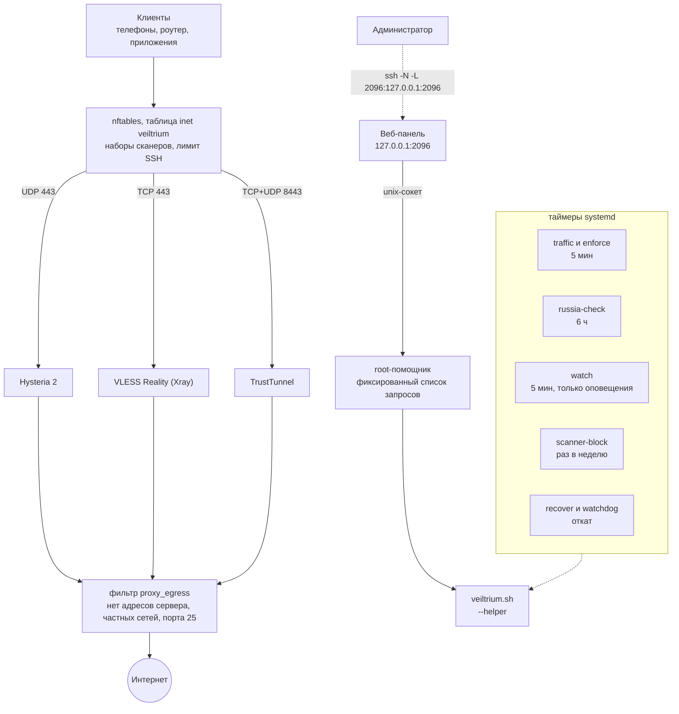

[English](README.md) | Русский

<div align="center">

# Veiltrium

**Secure Multi-Protocol VPN Deployment**

Automated, security-focused deployment of Hysteria2, VLESS Reality and TrustTunnel on Ubuntu VPS.

[](https://github.com/Vanilla-SilQ-HD/Veiltrium/tags)
[](https://github.com/Vanilla-SilQ-HD/Veiltrium/actions/workflows/fast.yml)
[](LICENSE)
[](#поддерживаемые-системы)

</div>

Veiltrium — один самодостаточный bash-установщик (`veiltrium.sh`), который превращает чистый сервер на Ubuntu в защищённый узел с тремя VPN-протоколами. Используются только официальные релизные бинарники каждого протокола, закреплённые по версии и SHA-256. Сторонних панелей, чужих установочных скриптов и `curl | sh` нет. Любое изменение рабочего узла проверяется настоящим клиентом и при неудаче откатывается само, а из российских сетей установщик проверяет, достижим ли сервер вообще.

Название: *Veil* (завеса, приватность), *Tri* (три протокола), *-ium* (химический элемент, символ **Vt**).

## Быстрый старт

На сервере под root:

```bash
curl -fsSLO https://raw.githubusercontent.com/Vanilla-SilQ-HD/Veiltrium/main/veiltrium.sh && bash veiltrium.sh
```

Прочитайте скрипт перед запуском: он меняет фаервол, настройки SSH и автообновления сервера. Установка занимает несколько минут, в конце выводятся данные подключения первого клиента. После неё доступна короткая команда `veiltrium`:

```bash
veiltrium status         # быстрый обзор узла
veiltrium add anna       # новый клиент со своими учётными данными для всех протоколов
veiltrium qr anna        # QR-коды ссылок клиента в терминале
```

## Содержание

- [Возможности](#возможности)
- [Сравнение с типичными скриптами](#сравнение-с-типичными-скриптами)
- [Архитектура](#архитектура)
- [Протоколы](#протоколы)
- [Поддерживаемые системы](#поддерживаемые-системы)
- [Использование](#использование)
- [Телефоны и приложения](#телефоны-и-приложения)
- [Переезд на новый сервер и запасные серверы](#переезд-на-новый-сервер-и-запасные-серверы)
- [Настройки](#настройки)
- [Модель безопасности](#модель-безопасности)
- [Справочник](#справочник)
- [Тесты](#тесты)
- [Известные ограничения](#известные-ограничения)
- [История изменений](#история-изменений)
- [Лицензия](#лицензия)

## Возможности

**Протоколы и TLS-идентичности**

- Hysteria 2, VLESS Reality (Vision) и TrustTunnel за один запуск; любой можно отключить (`REALITY_ENABLE=0`, `TT_ENABLE=0`).
- Раздельные TLS-идентичности: у каждого протокола своё имя сервера и свой сертификат, они сохраняются между запусками. Смена одного не трогает остальные.
- Измеренный выбор сайта для Reality: кандидатов проверяют напрямую и настоящим клиентом Reality на изолированном экземпляре в loopback. Выбор идёт по воспроизводимому счёту: без случайности и без ротации при повторных запусках.
- В приложениях узел называется `Veiltrium-<страна>` (например, `Veiltrium-PL`).

**Безопасность и защита сервера**

- Один неинтерактивный запуск под root: обновление системы, автообновления безопасности, защита SSH, фаервол, fail2ban, настройка ядра, три протокола, сквозная проверка и ссылки для клиентов.
- Каждый прокси работает под своим системным пользователем в песочнице systemd и не может обратиться к самому серверу, частным сетям и SMTP.
- Таблица nftables `inet veiltrium`: снаружи открыты только SSH и порты прокси; сети сканеров (список обновляется раз в неделю) порты прокси не видят.
- Секреты лежат в файлах только для root; данные подключения не попадают в журнал установки.

**Надёжность**

- Транзакционные изменения с автоматическим откатом: резервная копия, маркер pending, проверка настоящим клиентом, фиксация. Ошибка, Ctrl+C, SIGTERM, SIGKILL и обесточивание возвращают прежние настройки без ручных действий.
- Идемпотентные повторные запуски: обычный повторный запуск побайтно сохраняет пароли, ключи, сертификаты, ссылки и конфиги, не перезапускает службы, не рвёт соединения и не перезагружает рабочий узел.
- `--diagnose` и `--dry-run` ничего не меняют; отчёт в JSON без секретов лежит в `/var/lib/veiltrium/report.json`.

**Что видит цензор**

- Имя с сайта из списка РКН никогда не выбирается ни для Reality, ни для Hysteria, ни для TrustTunnel.
- Пробы [Globalping](https://globalping.io) в российских сетях (МТС, Ростелеком и другие) проверяют, отвечает ли адрес сервера: при установке, по запросу и автоматически каждые 6 часов.
- Обнаружение замирания ТСПУ: необязательный probe на роутере сообщает `stalled`, если туннель соединяется, но передача замирает после 16–20 КБ.
- Запасные серверы: до 3 дополнительных адресов в каждой ссылке и конфиге, чтобы телефоны и роутер сами переключались, если один адрес заблокируют.
- Экспорт и импорт переносят узел со всеми секретами на новый VPS; клиентам нужно сменить только адрес.

**Клиенты**

- `main` и любое число добавленных клиентов, у каждого свой пользователь и пароль Hysteria, UUID VLESS и логин TrustTunnel; одного можно отозвать или сбросить, не затрагивая остальных.
- Лимит трафика, срок действия, периодический сброс и ручное отключение для каждого клиента; применяются по таймеру.
- Счётчики трафика по клиентам и протоколам, без дополнительного ПО в пути данных.
- Для телефонов: подписка base64 и готовый профиль sing-box для каждого клиента, плюс QR-коды в терминале.

**Эксплуатация**

- Короткая команда `veiltrium` на сервере.
- Оповещения в Telegram-бот или вебхук (служба не работает, нет доступа из России, откат).
- Журнал аудита всех изменений, `--update` и `--check-update`, безопасное `--uninstall`.
- Веб-панель на английском и русском: обзор, клиенты, лимиты, трафик, ссылки, QR-коды, проверка из России.

## Сравнение с типичными скриптами

Сравнение с типичными скриптами установки VPN «в один клик» (общее, без названий проектов).

| | Типичный скрипт «в один клик» | Veiltrium |
|---|---|---|
| Бинарники | последний релиз или сторонняя панель, часто через `curl \| sh` | официальные релизы Hysteria и Xray, закреплённые по версии и SHA-256; endpoint TrustTunnel закреплён так же |
| Изменение рабочего узла | правка на месте, при сбое сервер остаётся наполовину настроенным | транзакция с проверкой настоящим клиентом; автоматический откат при ошибке, сигнале или обесточивании |
| Повторный запуск | часто пересоздаёт секреты или перезапускает службы | побайтно сохраняет секреты и конфиги, без перезапусков и перезагрузки |
| Изоляция служб | прокси работают от root | свой пользователь на каждый прокси, песочница systemd, фильтр исходящего трафика: сам сервер, частные сети и порт 25 закрыты |
| Админка | публичный порт с панелью | открытого порта нет: панель на `127.0.0.1`, вход через SSH-туннель, действия через root-помощник с фиксированным списком запросов |
| Самоподписанный TLS | `insecure=true` в ссылке | закрепление сертификата в ссылках и JSON для sing-box |
| Доступность из России | не проверяется | фильтр по списку РКН, проверка Globalping при установке и каждые 6 часов, необязательный probe с домашнего роутера |
| Переезд узла | переустановка и перевыпуск всех ссылок | зашифрованный экспорт и импорт, меняется только адрес |
| Тесты | нет или проверка синтаксиса | FAST на каждый push; полный сквозной набор FULL с настоящими клиентами на Ubuntu 26.04 и 24.04 |

## Архитектура



## Протоколы

| Протокол | Порт по умолчанию | TLS-идентичность | Клиент проверяет сервер по |
|---|---|---|---|
| Hysteria 2 (`v2.13.0`) | 443/UDP (QUIC) | свой самоподписанный сертификат (EC P-256) | закреплённому отпечатку: `pinSHA256` в ссылках, `certificate_public_key_sha256` в sing-box |
| VLESS + Reality + Vision (Xray `v26.3.27`) | 443/TCP | настоящий чужой HTTPS-сайт (Reality `target`/`serverNames`) | публичному ключу Reality, UUID и shortId |
| TrustTunnel (endpoint `v1.1.0`) | 8443/TCP+UDP (HTTP/2 и HTTP/3) | свой самоподписанный сертификат, встроенный в ссылку `tt://` | встроенному сертификату как единственному корню доверия |

Xray намеренно закреплён на `v26.3.27`. Начиная с `26.9.8` сервер Reality отвергает ClientHello без key share X25519MLKEM768, а клиенты sing-box по умолчанию его не отправляют.

## Поддерживаемые системы

- Ubuntu **26.04** (основная цель) и **24.04** (тоже проходит CI).
- amd64 и arm64.
- systemd, nftables и OpenSSH из стандартной поставки Ubuntu.

## Использование

Установщик пишет короткую команду `/usr/local/bin/veiltrium`, которая запускает установленную копию скрипта. Работает и любой ключ установщика, например `veiltrium --dry-run`; `veiltrium help` показывает все режимы и настройки.

| Короткая команда | Полная форма | Что делает |
|---|---|---|
| `veiltrium status` | `--status` | быстрый обзор без тестов и секретов (`--json -` для JSON) |
| `veiltrium clients` | `--list-clients` | клиенты узла |
| `veiltrium add NAME` | `--add-client NAME` | новый клиент; выводит данные, сохраняет `/root/veiltrium/clients/NAME.txt` |
| `veiltrium remove NAME` | `--remove-client NAME` | отозвать клиента |
| `veiltrium show NAME` | `--show-client NAME` | данные подключения клиента |
| `veiltrium qr NAME` | `--qr NAME` | QR-коды ссылок клиента в терминале |
| `veiltrium reset NAME` | `--reset-client NAME` | новые учётные данные под тем же именем |
| `veiltrium limit NAME ...`, `disable NAME`, `enable NAME` | `--set-client`, `--disable-client`, `--enable-client` | лимит, срок, периодический сброс, отключение и включение |
| `veiltrium traffic` | `--traffic` | трафик по клиентам |
| `veiltrium russia` | `--check-russia` | достигают ли сервер российские сети |
| `veiltrium diagnose` | `--diagnose` | проверить узел, ничего не меняя |
| `veiltrium audit [N]` | `--audit [N]` | последние N строк журнала аудита |
| `veiltrium export FILE` | `--export FILE` | упаковать узел с шифрованием |
| `veiltrium test-alert` | `--test-alert` | тестовое сообщение в каналы оповещений |
| `veiltrium check-update`, `update` | `--check-update`, `--update` | проверить новую версию, установить её |
| `veiltrium panel-password` | `--panel-password` | новый пароль веб-панели |
| `veiltrium uninstall` | `--uninstall` | удалить Veiltrium |
| `veiltrium install` | (без ключа) | то же, что повторный запуск установщика |

Ключи без короткой формы: `--reselect-reality`, `--dry-run`, `--trial-reality`, `--trial-stop`, `--enforce`, `--traffic-reset`, `--import`, `--import-mts`.

**Веб-панель.** На каждом узле есть небольшая панель на `127.0.0.1:2096`. Откройте туннель и зайдите на `http://localhost:2096/`:

```bash
ssh -N -L 2096:127.0.0.1:2096 root@SERVER_IP
```

Пароль выводится в конце установки и хранится в `/root/veiltrium/panel.txt`. Подробности — в [справочнике](#справочник) ниже.

## Телефоны и приложения

У каждого клиента есть два дополнительных файла рядом с файлом данных (`/root/veiltrium/client.*` для `main`, `/root/veiltrium/clients/NAME.*` для остальных, только root, для отключённого клиента их нет). Они же доступны в `--show-client NAME --json -` как `subscription_base64` и `singbox_profile`, а панель предлагает их в разделе импорта.

| Файл | Что это | Для чего |
|---|---|---|
| `.singbox.json` | готовый профиль sing-box: TUN-вход, DNS поверх HTTPS через прокси, исходящие Hysteria 2 и VLESS Reality, запасные серверы, группа `urltest` с именем `auto` и селектор `proxy`. Пин сертификата Hysteria проверяется. Нужен sing-box 1.12 или новее | приложения на базе sing-box: Hiddify, NekoBox, Karing, sing-box SFA/SFI |
| `.sub` | подписка base64: ссылки Hysteria 2 и VLESS, включая запасные, без TrustTunnel. `--qr NAME` печатает её и как QR-код, если она помещается | приложения на базе Xray: v2rayNG, v2rayN, Happ. Поддержка Hysteria 2 и её пина там зависит от приложения: лучше берите VLESS Reality |

- Если на телефоне в режиме VPN (TUN) соединение через несколько минут деградирует, попробуйте режим прокси в приложении или отключите sniffing.
- Для Reality оставляйте `fp=chrome`, не включайте TCP Fast Open и не используйте `fp=random`.
- Копируйте ссылки, не пропуская их через мессенджеры и рендереры Markdown: они портят `&` и `_`.

<details>
<summary>Совместимость с AWG Manager и sing-box</summary>

- **Hysteria 2.** AWG Manager намеренно отбрасывает `pinSHA256` из ссылок `hysteria2://` и импортирует их с `insecure=true`, то есть **без какой-либо проверки сертификата**. Вместо этого используйте раздел 6 файла `/root/veiltrium/client.txt`: блок JSON для sing-box с `certificate_public_key_sha256`, импортируется как группа серверов (sing-box JSON). Сборка sing-box на роутере (`1.15.0-alpha.12-awgm.33`) проверяет пин, в том числе поверх QUIC; CI проверяет это на той же сборке. `keenetic-vpn-probe.sh --check-awg` показывает, закреплён ли ключ в конфиге роутера на самом деле.
- **VLESS Reality.** Ссылка `vless://` импортируется как есть (`fp=chrome`, `flow=xtls-rprx-vision`).
- **TrustTunnel.** Ссылка `tt://` содержит сертификат. AWG Manager его проверяет, но использует только HTTP/2.
- **Клиенты sing-box вообще.** Берите JSON-outbound'ы из файла клиента. `certificate_public_key_sha256` — это base64 от SHA-256 публичного ключа (SPKI), а не то же значение, что hex-`pinSHA256` Hysteria.

</details>

## Переезд на новый сервер и запасные серверы

Если адрес сервера заблокировали, перенесите узел со всеми секретами: все клиенты продолжат работать, достаточно сменить адрес сервера в ссылке.

```bash
bash veiltrium.sh --export /root/node.vt        # старый сервер; спросит парольную фразу (от 12 символов)
scp /root/node.vt root@NEW_IP:/root/
bash veiltrium.sh --import /root/node.vt        # новый сервер; обычная установка, которая стартует из экспорта
```

Чтобы клиенты переключались сами, разверните второй VPS из экспорта и задайте на первом сервере `STANDBY_HOSTS=<его IPv4>`, затем запустите установщик ещё раз. После этого в каждой ссылке и конфиге будет и запасной сервер.

<details>
<summary>Подробности экспорта, импорта и запасных серверов</summary>

- В экспорте лежат ключи, пароли и сертификаты Hysteria, Reality и TrustTunnel, имена серверов, добавленные клиенты и ключ probe. Это tar с фиксированным списком файлов, зашифрованный `openssl enc -aes-256-cbc -pbkdf2 -iter 600000 -md sha256` (файл — обычный вывод openssl, режим 600, существующий файл не перезаписывается). Кто владеет файлом и парольной фразой, тот владеет узлом: храните их раздельно и удалите файл после переезда.
- Без терминала передавайте фразу в `VT_EXPORT_PASSPHRASE` / `VT_IMPORT_PASSPHRASE` (скрипт сразу убирает её из своего окружения).
- Перед размещением чего-либо импорт проверяет файл по именам (только обычные файлы из фиксированного списка, размеры, манифест SHA-256, точный формат каждого файла состояния, пары сертификат/ключ). Он работает только на сервере без узла или с тем же узлом (обновление запасной копии); чужой узел отвергается.
- Новый сервер получает новый пароль веб-панели и заново определяет страну для имени. Порты старого узла сохраняются, если вы не задали `REALITY_PORT` / `TT_PORT` сами.
- `STANDBY_HOSTS` принимает до 3 публичных адресов IPv4 через запятую, значение сохраняется; `none` очищает. Запасные серверы должны быть копиями этого узла с теми же портами. Они попадают в ссылки (hysteria2, vless, tt), в outbound'ы sing-box с группой `urltest` и в группу серверов AWG Manager. После добавления или удаления клиентов экспортируйте узел заново.

</details>

## Настройки

Необязательные настройки — переменные окружения, их пишут перед командой: `VAR=value bash veiltrium.sh`. Большинство сохраняется, поэтому следующие запуски их помнят.

<details>
<summary>Все настройки</summary>

| Переменная | По умолчанию | Значение |
|---|---|---|
| `REALITY_CANDIDATES` (старое имя `MASK_SITES`) | встроенный список из 10 сайтов | кандидаты для Reality; сохраняется; `default` возвращает встроенный список |
| `REALITY_SNI` | – | использовать именно этот сайт Reality (проверяется первым) |
| `HY2_SNI` | выбирается отдельно | SNI и имя сертификата Hysteria; сохраняется; `auto` выбирает новое независимое имя |
| `TT_SNI` | выбирается отдельно | имя хоста и сертификата TrustTunnel; сохраняется; `auto` так же |
| `HY2_MASQUERADE_URL` | `auto` (`https://<SNI Hysteria>`) | страница для HTTP/3-проберов; сохраняется |
| `REALITY_ENABLE`, `TT_ENABLE` | `1` | `0` отключает VLESS Reality или TrustTunnel |
| `HY2_PORT` | `443` | UDP-порт Hysteria; существующий узел сохраняет свой порт |
| `REALITY_PORT`, `TT_PORT` | `443`, `8443` | TCP-порт Reality, TCP+UDP-порт TrustTunnel; существующий узел сохраняет порты, если их не задать явно |
| `REALITY_FP` | `chrome` | отпечаток TLS-клиента в ссылке VLESS |
| `PUBLIC_IP` | определяется | адрес сервера для ссылок (за NAT) |
| `PANEL_ENABLE`, `PANEL_PORT` | `1`, `2096` | `0` отключает веб-панель; порт панели на `127.0.0.1` (сохраняется) |
| `GLOBALPING` | `1` | `0` отключает проверку из российских сетей (она отправляет адрес сервера в Globalping); сохраняется |
| `RU_BLOCKLISTS` | itdoginfo `Categories/block.lst` | URL списков блокировок РКН (домены по одному в строке) |
| `NODE_NAME` | страна сервера | имя узла в приложениях, `Veiltrium-<NODE_NAME>`; сохраняется; `auto` определяет страну заново, `none` даёт просто `Veiltrium` |
| `STANDBY_HOSTS` | нет | до 3 адресов запасных серверов; сохраняется; `none` очищает (см. выше) |
| `SCANNER_BLOCK` | `1` | `0` отключает блокировку сканеров |
| `ALERT_TG_TOKEN`, `ALERT_TG_CHAT`, `ALERT_WEBHOOK` | нет | каналы оповещений; сохраняются; `none` очищает (см. «Оповещения») |
| `VT_AUTO_REBOOT`, `AUTO_REBOOT_TIME` | `1`, `01:30` | **новый** узел сразу перезагружается, если этого требуют обновления; время ночной перезагрузки |
| `VT_RECONFIGURE` | `0` | `1` выпускает новые пароли, ключи и сертификаты, в том числе у добавленных клиентов (все клиенты нужно обновить) |
| `VT_YES` | – | `1` отвечает на вопрос `--update`; `uninstall` отвечает на вопрос `--uninstall` |
| `MTS_MAX_AGE_DAYS` | `14` | результаты probe из домашней сети старше этого срока игнорируются |

`HY2_RECONFIGURE` и `HY2_AUTO_REBOOT` по-прежнему работают как старые имена `VT_RECONFIGURE` и `VT_AUTO_REBOOT`.

</details>

## Модель безопасности

- **Фаервол (nftables, собственная таблица `inet veiltrium`).** Снаружи доступны только SSH и порты прокси. SSH ограничен по частоте. Сети сканеров из публичных списков (обновляются раз в неделю) видят только SSH, но не порты прокси. Чужие таблицы (например, fail2ban) не трогаются.
- **Изоляция исходящего трафика.** Пользователям прокси нельзя подключаться к собственным адресам сервера, частным диапазонам и порту 25.
- **SSH.** Усилен (`MaxAuthTries`, `LoginGraceTime`, `MaxStartups`, подробные логи), но вход по паролю и под root **не отключается**. Так задумано; перебор паролей гасят лимиты nftables, fail2ban и `PerSourcePenalties` в OpenSSH.
- **Обновления.** Автоматические обновления безопасности с окном ночной перезагрузки. `needrestart` настроен так, чтобы никогда не перезапускать прокси: обновление библиотеки не рвёт клиентов.
- **Секреты.** Файлы состояния доступны только root (`0600`). Данные подключения выводятся в терминал и сохраняются в `/root/veiltrium/client.txt`, но не попадают в журнал установки. В отчётах и результатах probe секретов нет.
- **Устойчивость к сбоям.** Изменение — транзакция: копия, маркер pending, проверка настоящим клиентом, фиксация. Откат срабатывает через ловушку EXIT (ошибки, Ctrl+C, SIGTERM), через таймер-сторож systemd (SIGKILL или зависший запуск) и через `veiltrium-recover.service` при загрузке (обесточивание).

<details>
<summary>Самоподписанные сертификаты: что они дают и чего не дают</summary>

Без домена Hysteria 2 и TrustTunnel используют самоподписанные сертификаты.

- **Они безопасны, только если клиент действительно их проверяет.** Клиент Hysteria должен закреплять сертификат (`pinSHA256` или `certificate_public_key_sha256` в sing-box). Клиент TrustTunnel должен доверять только встроенному сертификату.
- **Клиент с `insecure=true` без пина принимает любой сертификат.** Тогда перехватчик может прочитать пароль.
- **Самоподписанный сертификат никогда не выглядит как настоящий сайт, на имя которого он выписан.** Активный пробер это отличит. Только VLESS Reality показывает проберу подлинный сертификат настоящего сайта. Страница маскировки HTTP/3 у Hysteria отдаётся под самоподписанным сертификатом.
- Встроенный ACME в Hysteria не умеет получать сертификаты на IP-адрес (нет поддержки профилей ACME), а его проверки требуют порт 80 или TCP 443, который занят Reality. Поэтому единственный поддерживаемый режим — самоподписанный сертификат с закреплением.

</details>

## Справочник

Длинный справочный материал, свёрнутый.

<details>
<summary>Установка на чистый VPS</summary>

На сервере под root:

```bash
curl -fsSLO https://raw.githubusercontent.com/Vanilla-SilQ-HD/Veiltrium/main/veiltrium.sh
bash veiltrium.sh
```

Или скопируйте скрипт со своего компьютера:

```bash
git clone https://github.com/Vanilla-SilQ-HD/Veiltrium.git
scp Veiltrium/veiltrium.sh root@SERVER_IP:/root/
ssh root@SERVER_IP "bash /root/veiltrium.sh"
```

В конце установка выводит и сохраняет в `/root/veiltrium/client.txt` (только root):

- ссылку `hysteria2://` и outbound sing-box с закреплением ключа;
- ссылку `vless://` и outbound sing-box;
- ссылку `tt://`;
- блок JSON для sing-box под AWG Manager (раздел 6).

Например, чтобы скопировать ссылку из PowerShell:

```powershell
ssh root@SERVER_IP "grep -m1 '^vless://' /root/veiltrium/client.txt" | Set-Clipboard
```

</details>

<details>
<summary>Повторный запуск и переход с hy2-secure-install</summary>

Чтобы обновить или починить узел, запустите ту же команду ещё раз:

```bash
ssh root@SERVER_IP "bash /root/veiltrium.sh"
```

Обычный повторный запуск:

- сохраняет все пароли, ключи, UUID, shortId, сертификаты, имена серверов и ссылки;
- переписывает конфиги только с тем же содержимым, поэтому службы не перезапускаются, а активные соединения остаются;
- никогда не перезагружает рабочий узел (сообщает об ожидающей перезагрузке; действует ночное окно);
- сначала возвращает настройки прерванного ранее изменения.

**Узлы, установленные `hy2-secure-install.sh`** (прежнее название проекта, до `v2026.10.13.1` включительно), при первом запуске `veiltrium.sh` переезжают на имена Veiltrium:

- `/etc/hy2-secure` в `/etc/veiltrium`, `/var/lib/hy2-secure` в `/var/lib/veiltrium`;
- файлы root в `/root/veiltrium/` (`client.txt`, `clients/`, `probe.env`, `panel.txt`);
- таблица фаервола `inet hy2fw` в `inet veiltrium`, вспомогательные юниты и drop-in'ы (`veiltrium-scanner-block`, `veiltrium-recover`, sysctl, SSH, fail2ban, needrestart, apt) получают имена `veiltrium`;
- ключи, пароли, сертификаты, клиенты и ссылки не меняются; три службы прокси перезапускаются один раз (меняются комментарии в их конфигах), подключённые клиенты переподключаются за секунды;
- старые файлы удаляются в конце запуска. Результаты старого `keenetic-vpn-probe.sh` по-прежнему принимаются.

Режимы обслуживания берут тот же lock, что и установщик; первые три ничего не меняют на сервере.

```bash
bash /root/veiltrium.sh --diagnose            # проверить узел, ничего не меняя
bash /root/veiltrium.sh --diagnose --json /root/diag.json
bash /root/veiltrium.sh --dry-run             # что выбрал бы --reselect-reality, без изменений
bash /root/veiltrium.sh --check-russia        # достигают ли сервер российские сети? (Globalping)
bash /root/veiltrium.sh --help
```

</details>

<details>
<summary>Клиенты, сброс, лимиты и срок действия</summary>

Первого клиента, `main`, создаёт установщик (`/root/veiltrium/client.txt`). Остальные клиенты получают свои учётные данные для всех трёх протоколов: пользователя и пароль Hysteria, UUID VLESS и логин TrustTunnel. Отзыв одного клиента не влияет на остальных.

```bash
bash /root/veiltrium.sh --add-client anna      # выводит данные, сохраняет /root/veiltrium/clients/anna.txt
bash /root/veiltrium.sh --list-clients
bash /root/veiltrium.sh --show-client anna
bash /root/veiltrium.sh --remove-client anna
bash /root/veiltrium.sh --reset-client anna    # новые учётные данные, то же имя
```

- Имена: 1–32 символа, `a-z`, `0-9`, `_` и `-`, начинаются с буквы или цифры; `main` — первый клиент.
- Добавление или удаление клиента переписывает три серверных конфига одним изменением и перезапускает службы: подключённые клиенты переподключаются за несколько секунд. Затем настоящие клиенты проверяют, что `main` и новый клиент работают, а удалённый уже нет. Иначе возвращаются прежние настройки.
- Hysteria использует отдельный пароль на клиента (`user:password`). У узла, установленного до этой версии, один общий пароль. Первый `--add-client` переключает его, поэтому ссылка и JSON Hysteria у `main` меняются один раз; ссылки VLESS и TrustTunnel остаются прежними.
- Обычный повторный запуск сохраняет всех клиентов и их ссылки. Если меняется имя сервера или сертификат, файлы с данными клиентов переписываются с новыми ссылками.
- `veiltrium qr NAME` пишет только в терминал, потому что ссылки содержат секреты.

**Сброс учётных данных.** `--reset-client NAME` выдаёт добавленному клиенту новый UUID VLESS, новый пароль Hysteria и новый пароль TrustTunnel под тем же именем, например после потери телефона. Выполняется та же транзакция, что и при добавлении или удалении: три конфига меняются вместе, службы перезапускаются, а настоящие клиенты проверяют, что новые данные работают, старые Hysteria и VLESS уже нет, а `main` по-прежнему работает. Иначе возвращаются прежние настройки. Данные в `/root/veiltrium/clients/NAME.txt` переписываются и выводятся; передайте их клиенту. `main` так сбросить нельзя: `VT_RECONFIGURE=1 bash veiltrium.sh` заменяет секреты всего узла, включая добавленных клиентов.

**Лимиты и срок.** У добавленного клиента (но не у `main`) могут быть лимит трафика, дата окончания и периодический сброс; его можно отключить, не удаляя.

```bash
bash veiltrium.sh --set-client anna --limit 50G --expires 2027-01-31 --reset monthly
bash veiltrium.sh --set-client anna --limit none --expires none --reset none
bash veiltrium.sh --disable-client anna        # его учётные данные перестают работать; клиент остаётся
bash veiltrium.sh --enable-client anna
bash veiltrium.sh --enforce                    # применить лимиты и сроки сейчас
veiltrium limit anna --limit 50G               # короткая команда: limit, disable, enable
```

- `--limit SIZE|none`: просто байты или число с `K`, `M`, `G` или `T`; десятичные единицы (`1G` = 10^9 байт); не больше 10^15. Считается трафик в обе стороны по всем трём протоколам за текущий период.
- `--expires YYYY-MM-DD|none`: настоящая календарная дата (UTC); клиент работает до конца этого дня.
- `--reset none|daily|weekly|monthly`: когда счётчик начинается с нуля (UTC: каждый день, каждый понедельник, 1-е число месяца). При `none` трафик считается с момента установки лимита.
- Отключённый клиент исключается из конфигов Xray, Hysteria и TrustTunnel; файл с его данными в `/root/veiltrium/clients/` остаётся со строкой `DISABLED (причина)` сверху. Причина: `manual`, `quota` или `expired`. `--list-clients` показывает состояние, лимит, срок и сброс; в JSON `--list-clients` и `--show-client` есть поля `state`, `reason`, `limit`, `expires`, `reset`, `period_start` и `period_bytes`.
- Таймер трафика (каждые 5 минут) читает счётчики и, только если какой-то клиент должен измениться, запускает `--enforce`: останавливает клиентов, исчерпавших квоту или с истёкшим сроком, и возвращает тех, кого остановила квота или срок, которые больше не действуют (новый период, больший лимит, более поздняя дата). Все изменения одного запуска — одно изменение: конфиги, перезапуск, затем настоящие клиенты проверяют, что `main` работает, все клиенты, которые должны работать, работают, а остановленные больше не подключаются; иначе возвращаются прежние настройки (после этого таймер ждёт час до новой попытки). Ручное `--disable-client` таймер никогда не снимает; `--enable-client` отказывает, пока квота исчерпана или дата прошла, и подсказывает, что поменять. Во время пробы Reality и прерванного изменения ничего не запускается.
- Каждая смена состояния пишется в журнал аудита (`client-disabled`, `client-enabled`) и уходит в каналы оповещений, например `client anna disabled: quota 50 GB reached`. Изменение только настроек клиента, который остаётся в своём состоянии, ничего не перезапускает.

</details>

<details>
<summary>Счётчики трафика</summary>

Установщик считает трафик каждого клиента по протоколам: байты вверх (от клиента), вниз (к нему) и время последней активности.

```bash
bash /root/veiltrium.sh --traffic            # таблица; --json - для JSON
bash /root/veiltrium.sh --traffic-reset      # обнулить все счётчики
```

- Прокси считают сами; в пути данных ничего нет. Hysteria (`trafficStats`), Xray (`StatsService`) и TrustTunnel (`per_client_metrics`) отдают статистику на `127.0.0.1` на отдельном порту (у Hysteria ещё и секрет), который сохраняется в файле состояния протокола. Фаервол не пускает прокси к адресам самого сервера, поэтому клиенты не могут дотянуться до этих точек через туннель.
- `veiltrium-traffic.timer` читает их каждые 5 минут и непосредственно перед любым перезапуском службы (при перезапуске собственные счётчики прокси обнуляются) и добавляет значения в `/var/lib/veiltrium/traffic.json` (только root): итоги по клиентам и протоколам и по дням за последние 90 дней. Секретов и адресов клиентов там нет. Удалённый клиент уносит свои счётчики с собой.
- В JSON клиентов (`--list-clients`, `--show-client` с `--json -`) есть `traffic` по каждому клиенту, а в `--status` — итоги.
- Узел, установленный до этой функции, получает эти точки при следующем запуске установщика: Hysteria, Xray и TrustTunnel один раз перезапускаются, дальше повторные запуски снова ничего не меняют. Трафик до этого запуска не учитывается.
- Не учитывается то, что прошло между последним чтением и сбоем или перезагрузкой (не больше 5 минут).

</details>

<details>
<summary>Веб-панель</summary>

На каждом узле есть небольшая веб-панель: обзор узла и протоколов, клиенты с ссылками, QR-кодами и JSON для AWG Manager; клиентов можно добавлять, отзывать, сбрасывать, ограничивать и отключать. Интерфейс доступен на английском и русском.

```bash
ssh -N -L 2096:127.0.0.1:2096 root@SERVER_IP     # держите открытым, затем откройте http://localhost:2096/
```

- Пароль выводится в конце установки и хранится в `/root/veiltrium/panel.txt` (только root). `bash /root/veiltrium.sh --panel-password` задаёт новый и разлогинивает всех.
- **В интернет ничего нового не открывается.** Панель слушает только `127.0.0.1`; вход — через SSH-туннель. Прокси до неё не дотянутся (фаервол не пускает их к адресам самого сервера), а у самой панели нет доступа в интернет (systemd `IPAddressDeny`).
- **У веб-процесса нет привилегий.** `veiltrium-panel` (Go, один статический бинарник со встроенным интерфейсом) работает под своим пользователем в песочнице systemd. Каждое действие идёт через unix-сокет, открытый только группе этого пользователя, к root-помощнику, который systemd запускает на каждый запрос: это сам установщик в режиме `--helper`, он принимает фиксированный список запросов (status, list, show, add, remove, reset, set, disable, enable, audit, check-russia) с проверкой имён и выполняет тот же проверенный код, что и командная строка.
- Веб-правила: сессионная cookie (`HttpOnly`, `SameSite=Strict`), собственный заголовок и проверка same-origin на каждое изменение, допускаются только имена хоста `localhost` (нет DNS rebinding), строгая Content Security Policy без внешних ресурсов и блокировка после неудачных входов.
- Бинарник берётся из релизов этого репозитория (`panel-v*`), SHA-256 закреплён в установщике так же, как у прокси. `PANEL_ENABLE=0` отключает панель.
- У командной строки тот же машинный интерфейс: `--status`, `--list-clients`, `--show-client NAME`, `--add-client NAME`, `--remove-client NAME`, `--check-russia`, `--diagnose` и `--dry-run` принимают `--json -`.

</details>

<details>
<summary>Оповещения</summary>

По умолчанию выключены. Если задан канал, сервер сообщает о поломках; он только отправляет, ничего не слушает.

```bash
ALERT_TG_TOKEN=123456789:AAH... ALERT_TG_CHAT=123456789 bash veiltrium.sh   # Telegram-бот (из @BotFather) и id чата
ALERT_WEBHOOK=https://example.com/hook bash veiltrium.sh                     # или вебхук: JSON POST {node, server, event, text, time}
bash veiltrium.sh --test-alert                                               # тестовое сообщение; отчёт по каждому каналу
ALERT_TG_TOKEN=none ALERT_WEBHOOK=none bash veiltrium.sh                     # выключить
```

- Настройки строго проверяются, сохраняются в `/etc/veiltrium/alerts.env` (только root, 600) и остаются при следующих запусках. Токен никогда не выводится обратно (только `123456789:****`) и не пишется в журнал установки. В `curl` он попадает через конфиг на stdin, поэтому его нет ни в одной командной строке. Учтите, что переменная, набранная в оболочке, остаётся в её истории.
- События, каждое отправляется один раз при смене состояния: служба прокси не активна в двух проверках подряд (`veiltrium-watch.timer`, каждые 5 минут, существует только пока задан канал) и затем её восстановление; проверка из России дошла до `bad_streak` 2 (с советом переехать на новый сервер или использовать запасной адрес) и затем снова доступна; откат (запуск установки или изменение клиента не прошли проверки и были отменены).
- Неудачная доставка попадает в журнал (`journalctl -t veiltrium-alert`) и ничего не останавливает. В сообщениях есть имя узла, адрес сервера и короткая подсказка; секретов нет.

</details>

<details>
<summary>Обновления</summary>

```bash
bash veiltrium.sh --check-update      # есть ли новая версия? (--json - для JSON); без изменений
bash veiltrium.sh --update            # скачать, проверить, спросить, затем выполнить как обычную установку
```

- `--check-update` читает ленту релизов этого репозитория (только теги установщика `vYYYY.MM.DD[.N]`; теги панели игнорируются) и сравнивает с установленной версией по числам.
- `--update` скачивает `veiltrium.sh` этого тега с `raw.githubusercontent.com` в приватный файл, проверяет, что это bash-скрипт именно этой версии (`SCRIPT_VERSION` равен тегу, файл целый, `bash -n`), показывает `текущая -> новая` и просит ввести `yes` (`VT_YES=1` пропускает вопрос). Сам он ничего не заменяет: запускает новый скрипт как обычную установку с вашим окружением, и та обновляет установленную копию как обычно (ключи, пароли и клиенты сохраняются).
- Доверие то же, что и к однострочнику с `curl`: GitHub и HTTPS. Подписи пока нет.

</details>

<details>
<summary>Журнал аудита</summary>

Каждое действие, меняющее узел, добавляет одну строку в `/var/log/veiltrium/audit.log` (каталог `750`, файл `640`, только root; logrotate хранит шесть месячных файлов): время (UTC), источник (`cli` или `panel` для веб-панели), действие (`install`, `import`, `export`, `add-client`, `remove-client`, `reset-client`, `set-client`, `disable-client`, `enable-client`, `enforce`, `client-disabled`, `client-enabled`, `panel-password`, `traffic-reset`, `uninstall`), цель (имя клиента или файла) и результат (`ok`, `rolled-back` или `failed`). Секреты в журнал не пишутся.

```
2026-10-20T09:14:02Z source=panel action=add-client target=anna result=ok
```

```bash
bash /root/veiltrium.sh --audit          # последние 50 строк
bash /root/veiltrium.sh --audit 200
bash /root/veiltrium.sh --audit --json - # массив JSON
```

</details>

<details>
<summary>Удаление</summary>

```bash
bash /root/veiltrium.sh --uninstall      # просит ввести "uninstall"; VT_YES=uninstall отвечает без терминала
```

Скрипт перечисляет, что удалит, и ждёт это слово. Затем он останавливает и удаляет три службы прокси, панель и её помощник, все юниты и таймеры `veiltrium-*`, установленные программы (`hysteria`, `xray`, `trusttunnel_endpoint`, `veiltrium-panel`, `veiltrium-recover`, `veiltrium-scanner-block`), настройки и состояние (`/etc/hysteria`, `/usr/local/etc/xray`, `/etc/trusttunnel`, `/etc/veiltrium`, `/etc/veiltrium-panel`, `/var/lib/veiltrium`, `/usr/local/lib/veiltrium`), журнал установки, переопределение needrestart, таблицу фаервола `inet veiltrium`, свои строки в `/etc/nftables.conf` (файл правится и сначала проверяется `nft -c`; остальные строки остаются, а если там больше ничего не было, возвращается оригинал, сохранённый при установке) и четырёх служебных пользователей. **`/root/veiltrium` тоже удаляется**: там данные клиентов, профиль probe и пароль панели. После удаления всё, кроме SSH, снова доступно, если нет другого фаервола.

Скрипт не трогает то, что защищает сервер само по себе: настройки SSH (`/etc/ssh/sshd_config.d/00-veiltrium-hardening.conf`), fail2ban (`/etc/fail2ban/jail.d/veiltrium-sshd.local`), автообновления (`/etc/apt/apt.conf.d/52veiltrium-unattended-upgrades`, `20auto-upgrades`), journald (`/etc/systemd/journald.conf.d/50-veiltrium.conf`) и защиту ядра (`/etc/sysctl.d/99-zz-veiltrium-hardening.conf`, `/etc/modules-load.d/veiltrium-bbr.conf`); а также пакеты и журнал аудита. В последних строках вывода названы те из них, что остались, чтобы вы могли удалить их вручную. Второй запуск сообщает, что удалять нечего.

</details>

<details>
<summary>Управление SNI Reality</summary>

Сайт Reality выбирается на новом узле и меняется только по вашей просьбе:

```bash
bash /root/veiltrium.sh --dry-run             # сначала посмотреть оценки
bash /root/veiltrium.sh --reselect-reality    # оценить заново и сменить, если явно лучше
REALITY_SNI=www.example.com bash /root/veiltrium.sh --reselect-reality
```

**Как оценивается сайт.**

- Прямые проверки:
  - DNS возвращает только публичные адреса IPv4;
  - на каждом адресе (до 4): TLS 1.3 с X25519, ALPN h2 и сертификат, действительный для этого имени;
  - успешны минимум 2 из 3 HTTPS-рукопожатий по h2.
- Затем на loopback поднимается временный сервер Reality с собственными ключами узла (рабочая служба не затрагивается) и проверяется настоящим клиентом:
  - успешны минимум 2 из 3 запросов через туннель;
  - пробер без ключа должен получить настоящий сертификат сайта.

**Счёт** (меньше — лучше): медиана TLS + разброс + 250 × число сбоев TLS + медиана Reality + 250 × число сбоев Reality, −200 за подтверждённый успех из домашней сети, +600 за подтверждённый сбой из домашней сети. При равенстве остаётся порядок списка. Текущий сайт остаётся, если другой не лучше его больше чем на max(50, 25 %).

**При смене меняется только `sni` / `server_name` в ссылке VLESS.** UUID, ключи и shortId остаются, Hysteria и TrustTunnel не затрагиваются. Если новый сайт не проходит проверку на рабочем порту, возвращается прежний конфиг (код выхода 2).

**Проба из дома.** `--trial-reality` на ограниченное время добавляет дополнительные имена серверов через runtime drop-in и таймер. Перезагрузка тоже завершает пробу. Пока она идёт, пробер, использующий пробное имя, видит сертификат рабочего сайта, поэтому держите пробы короткими.

```bash
bash /root/veiltrium.sh --trial-reality www.example.com --trial-minutes 30
bash /root/veiltrium.sh --trial-stop
```

</details>

<details>
<summary>Что видит Россия: список РКН, Globalping, проверка каждые 6 часов</summary>

Проверка с европейского сервера ничего не говорит о домашнем провайдере в России. Две вещи установщик проверяет сам:

- **Имена из списка блокировок РКН.** Список скачивается при каждом выборе сайта (`RU_BLOCKLISTS`, по умолчанию отобранный itdoginfo `Categories/block.lst`: только блокировки РКН, без сайтов, которые сами закрыты для россиян геоблоком и для Reality значения не имеют). Кандидат из списка никогда не выбирается ни как сайт Reality, ни как имя Hysteria / TrustTunnel; `--diagnose` предупреждает, если используемое имя есть в списке.
- **Достижим ли адрес сервера из России?** В конце каждой установки, в `--diagnose`, при `--check-russia` и по кнопке *Check now* в панели пробы [Globalping](https://globalping.io) в российских сетях (две в МТС, две в Ростелекоме, ещё четыре из любой точки России) пингуют адрес и подключаются к TCP-портам Reality и TrustTunnel. Если не ответила ни одна, адрес заблокирован: попросите у хостера другой. Результат хранится в `/var/lib/veiltrium/russia.json` и показывается в панели.
- **Проверка повторяется каждые 6 часов** (`veiltrium-russia-check.timer`, старт через 20 минут после загрузки, со случайной задержкой; вывод в журнале), пока включён `GLOBALPING`. В `russia.json` хранится `bad_streak` — число проверок подряд с результатом `partly` или `blocked` (`reachable` сбрасывает его; проверка, на которую Globalping не ответил, ничего не меняет). Начиная с 2 подряд `--status` предупреждает, что адрес недоступен из России: подумайте о переезде на новый сервер или о переключении клиентов на запасной адрес.
- Адрес сервера отправляется в публичный сервис измерений Globalping. `GLOBALPING=0` (сохраняется) отключает автоматическую проверку; `--check-russia` по-прежнему работает по запросу.
- Ни одна из проверок не показывает, пропускает ли DPI протокол: это видно только в настоящем клиенте (например, по состоянию туннеля в AWG Manager).

</details>

<details>
<summary>Необязательно: probe с роутера Keenetic (обнаружение замирания ТСПУ)</summary>

`tools/keenetic-vpn-probe.sh` проверяет каждый протокол настоящими клиентами из самой домашней сети, через физический WAN роутера, и подписывает результаты для сервера (`--import-mts`), где подтверждённый успех учитывается в счёте сайта Reality. Для работающей конфигурации он не нужен.

Статусы домашней сети на сервере: `ok`, `fail`, `degraded`, `stalled`, `route_unverified`, `stale` (старше 14 дней) и `untested`. `stalled` значит, что туннель соединяется, но передача замирает после нескольких КБ (отсечка ТСПУ на 16–20 КБ): probe получил только часть полезной нагрузки. Такой результат даёт штраф в счёте сайта Reality, как `degraded`.

Результат, измеренный с европейского VPS, ничего не говорит о доступности из сети домашнего провайдера. `keenetic-vpn-probe.sh` работает на роутере (POSIX sh, BusyBox) и проверяет каждый сервер через физический WAN. Он использует временные клиенты только с локальным портом SOCKS: без TUN, без маршрутов, без изменений фаервола, AWG Manager продолжает работать.

В примерах используется SSH-сервер Entware на роутере (часто порт 222); подставьте свои адрес и порт.

1. Каждая установка пишет профиль probe `/root/veiltrium/probe.env` (в нём пароли; держите права `0600`). Скопируйте его на роутер, по одному файлу на сервер:

   ```bash
   ssh root@SERVER_IP "cat /root/veiltrium/probe.env" | ssh -p 222 root@ROUTER "mkdir -p /opt/etc/vpn-probe && cat > /opt/etc/vpn-probe/server1.env && chmod 600 /opt/etc/vpn-probe/server1.env"
   curl -fsSLO https://raw.githubusercontent.com/Vanilla-SilQ-HD/Veiltrium/main/tools/keenetic-vpn-probe.sh
   scp -O -P 222 keenetic-vpn-probe.sh root@ROUTER:/opt/bin/
   ```

2. На роутере установите утилиты и запустите probe. Укажите свой физический WAN-интерфейс; для PPPoE это обычно `ppp0`.

   ```sh
   opkg update && opkg install tcpdump jq curl
   ip -4 route get SERVER_IP; ip -4 rule show
   sh /opt/bin/keenetic-vpn-probe.sh --all --check-awg --wan ppp0 --output /opt/tmp/vpn-probe.json
   ```

   Параметры: `--reality`, `--hysteria`, `--trusttunnel`, `--trial-sni a,b`, `--runs N`, `--payload-bytes N`, `--payload-url URL`, `--profile FILE`, `--profile-dir DIR`, `--singbox PATH`, `--tt-client PATH`, `--help`.

3. Импортируйте результат на каждый сервер:

   ```bash
   ssh -p 222 root@ROUTER "cat /opt/tmp/vpn-probe.json" | ssh root@SERVER_IP "bash /root/veiltrium.sh --import-mts -"
   ```

**Что считается доказательством.**

- Результат учитывается только с `route: verified`: пакеты с собственных сокетов тестового клиента были замечены уходящими через физический WAN (tcpdump, для NAT — вместе с conntrack).
- Всё остальное — `route_unverified` и не учитывается. Сюда относятся VPN-интерфейс, указанный как WAN, локальный редирект и отсутствие доказательств.
- Один успех не доказывает, что DPI обойдён.

**Подписи.**

- Результаты подписываются HMAC-SHA256 ключом probe этого сервера.
- Строки каждого сервера связаны подписанным заголовком (число строк и хеш) и идентификатором прогона. Изменённые, неполные, чужие, старые и повторно присланные результаты отвергаются.
- Подпись доказывает, какой профиль выдал результат, но не где запускался probe. Для этого и нужны доказательства маршрута.

</details>

## Тесты

Два уровня:

- **FAST** (`tests/fast.sh`, workflow `fast.yml`, на каждый push, секунды): `bash -n`, shellcheck, проверка синтаксиса probe в `dash` и BusyBox, модульные тесты счёта, выбора, записей домашней сети, конфигов и ссылок клиентов и HMAC (векторы RFC 4231 и совпадение с OpenSSL для серверной и BusyBox-реализаций).
- **FULL** (workflow `e2e.yml`, около 30 минут; только вручную, на любой ветке, включая `main`, перед merge или релизом). Выполняется на Ubuntu 26.04 и 24.04 и покрывает чистую установку с проверкой фаервола из отдельного сетевого пространства имён, настоящие клиенты всех трёх протоколов, точную сборку sing-box с роутера, баны fail2ban, имитацию перезагрузки, повторные запуски с живыми соединениями, добавленных клиентов, веб-панель, все пути отката, локальные сайты-кандидаты для выбора Reality, probe для Keenetic под BusyBox и задание обновления с используемого релиза.

<details>
<summary>Что покрывает FULL</summary>

- чистая установка с проверкой фаервола из отдельного сетевого пространства имён;
- настоящие клиенты всех трёх протоколов;
- точная сборка sing-box с роутера;
- баны fail2ban;
- имитация перезагрузки;
- повторные запуски с живыми соединениями через все три протокола;
- добавленные клиенты: настоящие клиенты на каждом протоколе, повторный запуск с клиентами, откат неудачного изменения, отзыв;
- веб-панель: только loopback, недоступна прокси, правила запросов помощника, правила входа и CSRF, изменение клиента через API, новый пароль, повторный запуск без изменений;
- откат: SIGINT, SIGTERM, SIGKILL со сторожем, имитация обесточивания, сбои запуска systemd;
- локальные тестовые сайты для выбора Reality (недействительный сертификат, нет HTTP/2, мёртвый адрес CDN, таймауты, NXDOMAIN);
- probe для Keenetic под BusyBox с policy routing, редиректами, NAT и VPN, указанным как WAN;
- отдельное задание обновления с используемого релиза: секреты и ссылки не должны измениться, а первый добавленный клиент переключает Hysteria на отдельные пароли.

В CI нет российской домашней сети: всё, что касается доступности из сети домашнего провайдера, там симулируется, а для реальной проверки нужен probe на настоящем роутере.

</details>

## Известные ограничения

- **Нет домена.** Hysteria 2 и TrustTunnel самоподписанные; активный пробер это увидит (см. модель безопасности).
- **Закрепление зависит от клиента.** Оно защищает только клиентов, которые делают пиннинг. Импорт ссылки в AWG Manager этого не делает; используйте импорт JSON.
- **Счёт Reality измеряется с сервера.** Для доступности из домашней сети нужен probe для Keenetic, а для подтверждённого маршрута — `tcpdump` на роутере.
- **TrustTunnel по HTTP/3 в AWG Manager недоступен.** Роутер импортирует TrustTunnel только как HTTP/2.
- **Установщик написан для Ubuntu.** Другие дистрибутивы не поддерживаются.

## История изменений

См. [CHANGELOG.md](CHANGELOG.md).

## Лицензия

MIT, см. [LICENSE](LICENSE).
