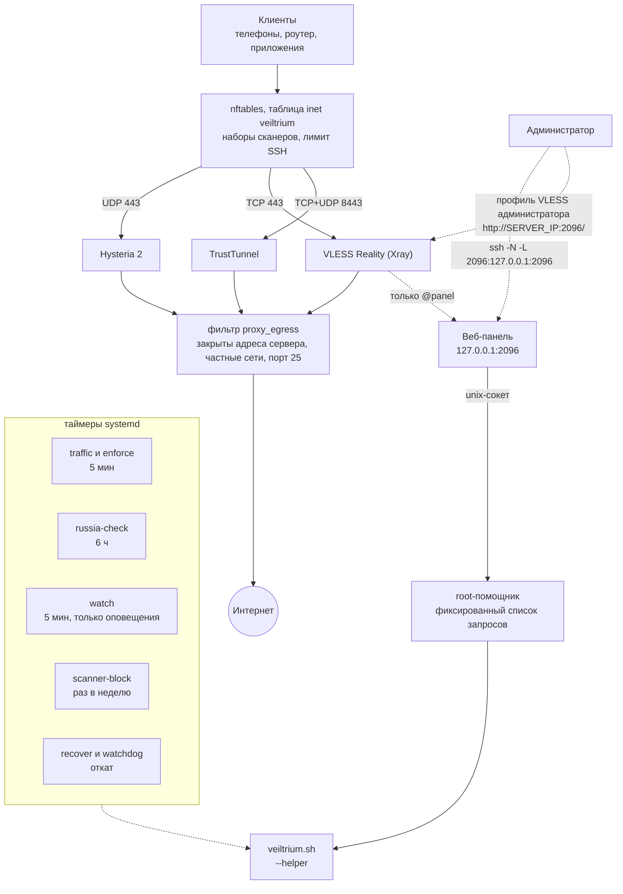

[English](README.md) | Русский

<div align="center">

# Veiltrium

**Secure Multi-Protocol VPN Deployment**

Automated, security-focused deployment of Hysteria2, VLESS Reality and TrustTunnel on Ubuntu VPS.

[](https://github.com/Vanilla-SilQ-HD/Veiltrium/tags)
[](https://github.com/Vanilla-SilQ-HD/Veiltrium/actions/workflows/fast.yml)
[](LICENSE)
[](#поддерживаемые-системы)

</div>

Veiltrium — самодостаточный установщик на Bash (`veiltrium.sh`): он превращает чистый сервер с Ubuntu в защищённый узел с тремя VPN-протоколами. Используются только официальные релизные бинарные файлы протоколов, закреплённые по версии и SHA-256. Сторонних панелей, чужих скриптов установки и `curl | sh` нет. Каждое изменение рабочего узла проверяется настоящим клиентом и при неудаче автоматически откатывается. Кроме того, установщик проверяет из российских сетей, доступен ли сервер вообще.

Название: *Veil* (завеса, приватность), *Tri* (три протокола), *-ium* (суффикс названий химических элементов, символ **Vt**).

## Быстрый старт

На сервере под root:

```bash
curl -fsSLO https://raw.githubusercontent.com/Vanilla-SilQ-HD/Veiltrium/main/veiltrium.sh && bash veiltrium.sh
```

Прочитайте скрипт, прежде чем запускать его: он меняет фаервол, настройки SSH и автоматические обновления сервера. Установка занимает несколько минут, в конце выводятся данные подключения первого клиента. После неё доступна короткая команда `veiltrium`:

```bash
veiltrium status         # быстрый обзор узла
veiltrium add anna       # новый клиент со своими учётными данными для всех протоколов
veiltrium qr anna        # QR-коды ссылок клиента в терминале
```

## Содержание

- [Возможности](#возможности)
- [Сравнение с типичными скриптами](#сравнение-с-типичными-скриптами)
- [Архитектура](#архитектура)
- [Протоколы](#протоколы)
- [Поддерживаемые системы](#поддерживаемые-системы)
- [Использование](#использование)
- [Телефоны и приложения](#телефоны-и-приложения)
- [Переезд на новый сервер и резервные серверы](#переезд-на-новый-сервер-и-резервные-серверы)
- [Настройки](#настройки)
- [Модель безопасности](#модель-безопасности)
- [Справочник](#справочник)
- [Тесты](#тесты)
- [Известные ограничения](#известные-ограничения)
- [История изменений](#история-изменений)
- [Лицензия](#лицензия)

## Возможности

**Протоколы и TLS-идентичности**

- Hysteria 2, VLESS Reality (Vision) и TrustTunnel за один запуск; Reality и TrustTunnel можно отключить (`REALITY_ENABLE=0`, `TT_ENABLE=0`).
- Раздельные TLS-идентичности: у каждого протокола своё имя сервера и свой сертификат, которые сохраняются между запусками. Смена одного не затрагивает остальные.
- Выбор сайта для Reality по измерениям: кандидатов проверяют напрямую и настоящим клиентом Reality на изолированном экземпляре, который слушает только loopback. Выбор делается по воспроизводимому счёту: без случайных решений и без смены сайта при повторных запусках.
- В приложениях узел называется `Veiltrium-<страна>` (например, `Veiltrium-PL`).

**Безопасность и защита сервера**

- Один неинтерактивный запуск под root: обновление системы, автоматические обновления безопасности, усиление защиты SSH, фаервол, fail2ban, параметры ядра, три протокола, сквозная проверка и ссылки для клиентов.
- Каждый прокси работает под своим системным пользователем в песочнице systemd и не может обращаться к самому серверу, частным сетям и SMTP.
- Таблица nftables `inet veiltrium`: снаружи открыты только SSH и порты прокси; сети сканеров (список обновляется раз в неделю) не видят портов прокси.
- Секреты лежат в файлах только для root; данные подключения не попадают в журнал установки.

**Надёжность**

- Транзакционные изменения с автоматическим откатом: резервная копия, маркер pending, проверка настоящим клиентом, фиксация. Ошибка, Ctrl+C, SIGTERM, SIGKILL и внезапное отключение питания возвращают прежние настройки без ручных действий.
- Безопасные повторные запуски: обычный повторный запуск побайтно сохраняет пароли, ключи, сертификаты, ссылки и конфиги, не перезапускает службы, не рвёт соединения и не перезагружает рабочий узел.
- `--diagnose` и `--dry-run` ничего не меняют; JSON-отчёт без секретов лежит в `/var/lib/veiltrium/report.json`.

**Учёт блокировок**

- Имя сайта из списка блокировок Роскомнадзора (РКН) никогда не выбирается ни для Reality, ни для Hysteria 2, ни для TrustTunnel.
- Пробы [Globalping](https://globalping.io) в российских сетях (МТС, Ростелеком и другие) проверяют, отвечает ли адрес сервера: при установке, по запросу и автоматически каждые 6 часов.
- Обнаружение зависания передачи (ТСПУ): необязательная проверка с роутера сообщает `stalled`, если туннель устанавливается, но передача замирает после 16–20 КБ (так трафик отсекает ТСПУ — оборудование DPI российских провайдеров).
- Резервные серверы: до 3 дополнительных адресов в каждой ссылке и каждом конфиге, чтобы телефоны и роутер переключались сами, если один адрес заблокируют.
- Экспорт и импорт переносят узел со всеми секретами на новый VPS; клиентам нужно сменить только адрес.

**Клиенты**

- `main` и любое число добавленных клиентов, у каждого свой пользователь и пароль Hysteria, UUID VLESS, логин и пароль TrustTunnel; любого можно отозвать или сбросить, не затрагивая остальных.
- У каждого клиента свои лимит трафика, срок действия, периодический сброс и ручное отключение; лимиты и сроки применяет таймер.
- Счётчики трафика по клиентам и протоколам; в пути данных нет дополнительного ПО.
- Для телефонов: подписка в base64 и готовый профиль sing-box для каждого клиента, а также QR-коды в терминале.

**Эксплуатация**

- Короткая команда `veiltrium` на сервере.
- Оповещения в Telegram-бот или на вебхук: служба не работает, сервер недоступен из России, выполнен откат.
- Журнал аудита всех изменений, `--check-update` и `--update`, безопасное удаление (`--uninstall`).
- Веб-панель на английском и русском: обзор, клиенты, лимиты, трафик, ссылки, QR-коды, проверка из России.

## Сравнение с типичными скриптами

Сравнение Veiltrium с типичными скриптами установки VPN «в один клик» (обобщённое, без названий проектов).

| | Типичный скрипт «в один клик» | Veiltrium |
|---|---|---|
| Бинарники | последний релиз или сторонняя панель, часто через `curl \| sh` | официальные релизы Hysteria и Xray, закреплённые по версии и SHA-256; endpoint TrustTunnel закреплён так же |
| Изменение рабочего узла | правка на месте; после сбоя сервер остаётся настроенным наполовину | транзакция с проверкой настоящим клиентом; автоматический откат при ошибке, сигнале или отключении питания |
| Повторный запуск | часто пересоздаёт секреты или перезапускает службы | побайтно сохраняет секреты и конфиги, без перезапусков и перезагрузки |
| Изоляция служб | прокси работают от root | свой пользователь на каждый прокси, песочница systemd, фильтр исходящего трафика: сам сервер, частные сети и порт 25 закрыты |
| Интерфейс администратора | публичный порт с панелью | открытого порта нет: панель на `127.0.0.1`, вход через SSH-туннель или отдельный профиль VLESS администратора, действия через root-помощник с фиксированным списком запросов |
| Самоподписанный TLS | `insecure=true` в ссылке | закрепление сертификата в ссылках и JSON для sing-box |
| Доступность из России | не проверяется | фильтр по списку РКН, проверка Globalping при установке и каждые 6 часов, необязательная проверка с домашнего роутера |
| Переезд узла | переустановка и перевыпуск всех ссылок | зашифрованный экспорт и импорт, меняется только адрес |
| Тесты | нет или проверка синтаксиса | быстрые проверки FAST на каждый push; полный сквозной набор FULL с настоящими клиентами на Ubuntu 26.04 и 24.04 |

## Архитектура



## Протоколы

| Протокол | Порт по умолчанию | TLS-идентичность | Клиент проверяет сервер по |
|---|---|---|---|
| Hysteria 2 (`v2.13.0`) | 443/UDP (QUIC) | свой самоподписанный сертификат (EC P-256) | закреплённому отпечатку (пину): `pinSHA256` в ссылках, `certificate_public_key_sha256` в sing-box |
| VLESS + Reality + Vision (Xray `v26.3.27`) | 443/TCP | настоящий сторонний HTTPS-сайт (Reality `target`/`serverNames`) | публичному ключу Reality, UUID и shortId |
| TrustTunnel (endpoint `v1.1.0`) | 8443/TCP+UDP (HTTP/2 и HTTP/3) | свой самоподписанный сертификат, встроенный в ссылку `tt://` | встроенному сертификату как единственному корню доверия |

Версия Xray намеренно закреплена на `v26.3.27`. Начиная с `26.9.8` сервер Reality отвергает ClientHello без key share X25519MLKEM768, а клиенты sing-box по умолчанию его не отправляют.

## Поддерживаемые системы

- Ubuntu **26.04** (основная цель) и **24.04** (тоже проверяется в CI).
- amd64 и arm64.
- systemd, nftables и OpenSSH из стандартной поставки Ubuntu.

## Использование

Установщик создаёт короткую команду `/usr/local/bin/veiltrium`, которая запускает установленную копию скрипта. Работает и любая опция установщика, например `veiltrium --dry-run`; `veiltrium help` показывает все режимы и настройки.

| Короткая команда | Полная форма | Что делает |
|---|---|---|
| `veiltrium status` | `--status` | быстрый обзор без тестов и секретов (`--json -` для JSON) |
| `veiltrium clients` | `--list-clients` | клиенты узла |
| `veiltrium add NAME` | `--add-client NAME` | новый клиент; выводит данные, сохраняет `/root/veiltrium/clients/NAME.txt` |
| `veiltrium remove NAME` | `--remove-client NAME` | отозвать клиента |
| `veiltrium show NAME` | `--show-client NAME` | данные подключения клиента |
| `veiltrium qr NAME` | `--qr NAME` | QR-коды ссылок клиента в терминале |
| `veiltrium reset NAME` | `--reset-client NAME` | новые учётные данные под тем же именем |
| `veiltrium limit NAME ...`, `disable NAME`, `enable NAME` | `--set-client`, `--disable-client`, `--enable-client` | лимит, срок, периодический сброс, отключение и включение |
| `veiltrium traffic` | `--traffic` | трафик по клиентам |
| `veiltrium russia` | `--check-russia` | доступен ли сервер из российских сетей |
| `veiltrium diagnose` | `--diagnose` | проверить узел, ничего не меняя |
| `veiltrium audit [N]` | `--audit [N]` | последние N строк журнала аудита |
| `veiltrium export FILE` | `--export FILE` | упаковать узел в зашифрованный файл |
| `veiltrium test-alert` | `--test-alert` | тестовое сообщение в каналы оповещений |
| `veiltrium check-update`, `update` | `--check-update`, `--update` | проверить наличие новой версии, установить её |
| `veiltrium panel-password` | `--panel-password` | новый пароль веб-панели |
| `veiltrium uninstall` | `--uninstall` | удалить Veiltrium |
| `veiltrium install` | (без опции) | то же, что повторный запуск установщика |

Опции без короткой формы: `--reselect-reality`, `--dry-run`, `--trial-reality`, `--trial-minutes`, `--trial-stop`, `--enforce`, `--traffic-reset`, `--import`, `--import-mts`.

**Веб-панель.** На каждом узле есть небольшая панель на `127.0.0.1:2096`. Откройте туннель и перейдите по адресу `http://localhost:2096/`:

```bash
ssh -N -L 2096:127.0.0.1:2096 root@SERVER_IP
```

Или без SSH: импортируйте профиль VLESS администратора из `/root/veiltrium/panel.txt` в VPN-приложение, подключитесь с ним и откройте `http://SERVER_IP:2096/`.

Пароль выводится в конце установки и хранится в `/root/veiltrium/panel.txt`. Подробности — в записи о веб-панели [справочника](#справочник) ниже.

## Телефоны и приложения

У каждого клиента есть два дополнительных файла рядом с файлом данных (`/root/veiltrium/client.*` для `main`, `/root/veiltrium/clients/NAME.*` для остальных; доступны только root; у отключённого клиента их нет). Те же данные есть в `--show-client NAME --json -` в полях `subscription_base64` и `singbox_profile`, а панель предлагает их в разделе «Импорт в приложения».

| Файл | Что это | Для чего |
|---|---|---|
| `.singbox.json` | готовый профиль sing-box: TUN-вход, DNS поверх HTTPS через прокси, исходящие подключения Hysteria 2 и VLESS Reality, резервные серверы, группа `urltest` с тегом `auto` и селектор `proxy`. Пин сертификата Hysteria проверяется. Нужен sing-box 1.12 или новее | приложения на базе sing-box: Hiddify, NekoBox, Karing, sing-box SFA/SFI |
| `.sub` | подписка в base64: ссылки Hysteria 2 и VLESS, включая резервные, без TrustTunnel. `--qr NAME` печатает и её QR-код, если подписка в него помещается | приложения на базе Xray: v2rayNG, v2rayN, Happ. Поддержка Hysteria 2 и проверки пина зависит от приложения: лучше выбирайте VLESS Reality |

- Если на телефоне в режиме VPN (TUN) соединение через несколько минут ухудшается, попробуйте режим прокси в приложении или отключите sniffing.
- Для Reality оставляйте `fp=chrome`, не включайте TCP Fast Open и не используйте `fp=random`.
- Копируйте ссылки напрямую, не пересылая их через мессенджеры и не открывая в рендерерах Markdown: они портят `&` и `_`.

<details>
<summary>Совместимость с AWG Manager и sing-box</summary>

- **Hysteria 2.** AWG Manager намеренно отбрасывает `pinSHA256` из ссылок `hysteria2://` и импортирует их с `insecure=true`, то есть **без какой-либо проверки сертификата**. Вместо этого используйте раздел 6 файла `/root/veiltrium/client.txt`: блок JSON для sing-box с `certificate_public_key_sha256`; его нужно импортировать как группу серверов (sing-box JSON). Сборка sing-box на роутере (`1.15.0-alpha.12-awgm.33`) проверяет пин, в том числе поверх QUIC; CI проверяет это на точно такой же сборке. `keenetic-vpn-probe.sh --check-awg` показывает, закреплён ли ключ в конфиге роутера на самом деле.
- **VLESS Reality.** Ссылка `vless://` импортируется как есть (`fp=chrome`, `flow=xtls-rprx-vision`).
- **TrustTunnel.** Ссылка `tt://` содержит сертификат. AWG Manager его проверяет, но использует только HTTP/2.
- **Другие клиенты sing-box.** Берите блоки JSON outbound из файла клиента. `certificate_public_key_sha256` — это SHA-256 публичного ключа (SPKI) в кодировке base64, а не то же значение, что `pinSHA256` Hysteria в hex.

</details>

## Переезд на новый сервер и резервные серверы

Если адрес сервера заблокировали, перенесите узел со всеми секретами: клиенты продолжат работать, нужно только сменить адрес сервера в ссылке.

```bash
bash veiltrium.sh --export /root/node.vt        # старый сервер; спросит парольную фразу (от 12 символов)
scp /root/node.vt root@NEW_IP:/root/
bash veiltrium.sh --import /root/node.vt        # новый сервер; обычная установка, которая берёт данные из экспорта
```

Чтобы клиенты переключались автоматически, разверните второй VPS из экспорта, задайте на первом сервере `STANDBY_HOSTS=<IPv4 второго сервера>` и запустите установщик ещё раз. После этого в каждой ссылке и каждом конфиге будет указан и резервный сервер.

<details>
<summary>Подробности экспорта, импорта и резервных серверов</summary>

- В экспорте лежат ключи, пароли и сертификаты Hysteria, Reality и TrustTunnel, имена серверов, добавленные клиенты и ключ подписи проверок с роутера. Это tar с фиксированным списком файлов, зашифрованный `openssl enc -aes-256-cbc -pbkdf2 -iter 600000 -md sha256` (файл — обычный вывод openssl, режим 600, существующий файл не перезаписывается). Любой, у кого есть файл и парольная фраза, получает узел целиком: храните их раздельно и удалите файл после переезда.
- Без терминала передавайте парольную фразу в `VT_EXPORT_PASSPHRASE` / `VT_IMPORT_PASSPHRASE` (скрипт сразу убирает её из своего окружения).
- Прежде чем что-либо записать на диск, импорт проверяет файл: имена (только обычные файлы из фиксированного списка), размеры, манифест SHA-256, точный формат каждого файла состояния, пары сертификат/ключ. Импорт работает только на сервере без узла или с тем же узлом (обновление резервной копии узла); чужой узел отвергается.
- Новый сервер получает новый пароль веб-панели и заново определяет страну для имени узла. Порты старого узла сохраняются, если вы не задали `REALITY_PORT` / `TT_PORT` сами.
- `STANDBY_HOSTS` принимает до 3 публичных адресов IPv4 через запятую; значение сохраняется, `none` его очищает. Резервные серверы должны быть копиями этого узла с теми же портами. Они попадают в ссылки (hysteria2, vless, tt), в блоки outbound для sing-box с группой `urltest` и в группу серверов AWG Manager. После добавления или удаления клиентов экспортируйте узел заново.

</details>

### Обзор состояния и подключение устройства

Веб-панель разделяет три вида сведений: запущенные службы, доступность адреса по Globalping и передачу через настоящий туннель из домашней сети. Для каждого результата показана дата. Пробы адреса считаются свежими 12 часов, домашние проверки — `MTS_MAX_AGE_DAYS` (по умолчанию 14 дней). Ответ порта не считается доказательством работы VPN; отсутствие ответа не доказывает блокировку. Обзор предлагает следующий шаг: диагностику, повторную проверку адреса, проверку с роутера или подключение устройства.

В карточке клиента мастер «Подключить устройство» ведет по четырем шагам: устройство → приложение и формат → импорт → проверка сайта и загрузки больше 1 МБ. Поддержаны Android, iPhone/iPad, Windows и Keenetic/AWG Manager. Полный JSON предназначен для приложений, которые явно умеют импортировать полный конфиг sing-box; наличия ядра sing-box недостаточно. Все прежние ссылки и QR находятся в раскрываемых подробных данных. Отметки в конце мастера — подтверждение пользователя в текущей вкладке, а не измерения панели.

### Проверка актуальности резервов

На резервном сервере выполни:

```bash
veiltrium standby-receipt
```

Вставь всю полученную строку `vt-standby-1|…` в основном узле: «Обзор → Актуальность резервных серверов → Проверить / инструкция». Через терминал:

```bash
veiltrium verify-standby 'vt-standby-1|…'
veiltrium standby-status
```

На обоих серверах нужна версия скрипта с этими командами. Резерв должен быть развернут из того же экспорта с общим ключом проверок, а его адрес — присутствовать в `STANDBY_HOSTS` основного сервера. Подтверждение не содержит секретов: HMAC общим ключом защищает снимок и отпечаток от подмены. Это подтверждение от обладателя общего ключа, а не независимая аттестация сервера.

Сравниваются учетные данные основного и добавленных клиентов, ограничения и состояния клиентов, сертификаты, имена протоколов и порты. Адрес, имя узла, администратор панели, статистические порты и счетчики трафика могут различаться. Успешное сравнение означает только **совпадение сохраненных настроек на момент снимка**. Оно действует 24 часа; состояние на удаленном сервере могло измениться после снимка. Сравнение не проверяет доступность, примененный конфиг процесса или работоспособность туннеля. Изменения на основном сервере обнаруживаются при следующем обновлении обзора. Неверная подпись, неизвестный адрес, слишком старый или будущий снимок отвергаются; более старый снимок не заменяет новый.

Отключение, отзыв, сброс учетных данных и изменение ограничений действуют только на локальном сервере. На резерве старые данные могут продолжать работать. Перед такими операциями панель напоминает обновить копии. Экспортируй основной узел в новый зашифрованный архив, перенеси его на резерв и выполни там `bash veiltrium.sh --import /root/node-backup.enc`; затем получи и проверь новое подтверждение. Архив с измененными общими учетными данными основного клиента может требовать чистого целевого узла согласно правилам импорта. При изменении портов или имен обнови профили на устройствах.

Лимиты трафика **локальны для каждого сервера**: общего счетчика и автоматической синхронизации нет. Таймеры могут независимо отключать клиентов по лимиту или сроку; это также меняет сравниваемое состояние.

## Настройки

Необязательные настройки — переменные окружения, которые указывают перед командой: `VAR=value bash veiltrium.sh`. Большинство значений сохраняется, и следующие запуски их учитывают.

<details>
<summary>Все настройки</summary>

| Переменная | По умолчанию | Значение |
|---|---|---|
| `REALITY_CANDIDATES` (старое имя `MASK_SITES`) | встроенный список из 10 сайтов | кандидаты для Reality; сохраняется; `default` возвращает встроенный список |
| `REALITY_SNI` | – | использовать именно этот сайт Reality (проверяется первым) |
| `HY2_SNI` | выбирается отдельно | SNI и имя сертификата Hysteria; сохраняется; `auto` выбирает новое независимое имя |
| `TT_SNI` | выбирается отдельно | имя хоста и сертификата TrustTunnel; сохраняется; `auto` — как у Hysteria |
| `HY2_MASQUERADE_URL` | `auto` (`https://<SNI Hysteria>`) | страница, которую получают активные зонды по HTTP/3; сохраняется |
| `REALITY_ENABLE`, `TT_ENABLE` | `1` | `0` отключает VLESS Reality или TrustTunnel |
| `HY2_PORT` | `443` | UDP-порт Hysteria; существующий узел сохраняет свой порт |
| `REALITY_PORT`, `TT_PORT` | `443`, `8443` | TCP-порт Reality, TCP+UDP-порт TrustTunnel; существующий узел сохраняет порты, если их не задать явно |
| `REALITY_FP` | `chrome` | отпечаток TLS-клиента в ссылке VLESS |
| `PUBLIC_IP` | определяется | адрес сервера для ссылок (за NAT) |
| `PANEL_ENABLE`, `PANEL_PORT` | `1`, `2096` | `0` отключает веб-панель; порт панели на `127.0.0.1` (сохраняется) |
| `PANEL_VPN` | `1` | `0`: панель только через SSH-туннель, без профиля VLESS администратора (сохраняется) |
| `GLOBALPING` | `1` | `0` отключает проверку из российских сетей (она отправляет адрес сервера в Globalping); сохраняется |
| `RU_BLOCKLISTS` | itdoginfo `Categories/block.lst` | URL списков блокировок РКН (домены по одному в строке) |
| `NODE_NAME` | страна сервера | имя узла в приложениях, `Veiltrium-<NODE_NAME>`; сохраняется; `auto` определяет страну заново, `none` даёт просто `Veiltrium` |
| `STANDBY_HOSTS` | нет | до 3 адресов резервных серверов; сохраняется; `none` очищает (см. выше) |
| `SCANNER_BLOCK` | `1` | `0` отключает блокировку сканеров |
| `ALERT_TG_TOKEN`, `ALERT_TG_CHAT`, `ALERT_WEBHOOK` | нет | каналы оповещений; сохраняются; `none` очищает (см. «Оповещения») |
| `VT_AUTO_REBOOT`, `AUTO_REBOOT_TIME` | `1`, `01:30` | **новый** узел сразу перезагружается, если этого требуют обновления; время ночной перезагрузки (по времени сервера) |
| `VT_RECONFIGURE` | `0` | `1` выпускает новые пароли, ключи и сертификаты, в том числе у добавленных клиентов (все клиенты нужно обновить) |
| `VT_YES` | – | `1` подтверждает вопрос `--update`; значение `uninstall` подтверждает вопрос `--uninstall` |
| `MTS_MAX_AGE_DAYS` | `14` | результаты проверок с домашнего роутера старше этого числа дней игнорируются |

`HY2_RECONFIGURE` и `HY2_AUTO_REBOOT` по-прежнему работают как старые имена `VT_RECONFIGURE` и `VT_AUTO_REBOOT`.

</details>

## Модель безопасности

- **Фаервол (nftables, собственная таблица `inet veiltrium`).** Снаружи доступны только SSH и порты прокси. Число подключений по SSH ограничено. Сети сканеров из публичных списков (обновляются раз в неделю) видят только SSH, но не порты прокси. Чужие таблицы (например, fail2ban) не трогаются.
- **Изоляция исходящего трафика.** Пользователям прокси запрещено подключаться к адресам самого сервера, частным диапазонам и порту 25.
- **SSH.** Защита усилена (`MaxAuthTries`, `LoginGraceTime`, `MaxStartups`, подробное журналирование), но вход по паролю и под root **не отключается**. Так задумано: перебор паролей ограничивают лимиты nftables, fail2ban и `PerSourcePenalties` в OpenSSH.
- **Обновления.** Автоматические обновления безопасности с окном ночной перезагрузки. `needrestart` настроен так, что прокси не перезапускает никогда, поэтому обновление библиотеки не обрывает соединения клиентов.
- **Секреты.** Файлы состояния доступны только root (`0600`). Данные подключения выводятся в терминал и сохраняются в `/root/veiltrium/client.txt`, но не попадают в журнал установки. В отчётах и результатах probe секретов нет.
- **Устойчивость к сбоям.** Изменение — транзакция: резервная копия, маркер pending, проверка настоящим клиентом, фиксация. Откат срабатывает через ловушку EXIT (ошибки, Ctrl+C, SIGTERM), через таймер-сторож systemd (SIGKILL или зависший запуск) и через `veiltrium-recover.service` при загрузке (отключение питания).

<details>
<summary>Самоподписанные сертификаты: что они дают и чего не дают</summary>

Без домена Hysteria 2 и TrustTunnel используют самоподписанные сертификаты.

- **Они безопасны, только если клиент действительно их проверяет.** Клиент Hysteria должен закреплять сертификат (`pinSHA256` или `certificate_public_key_sha256` в sing-box). Клиент TrustTunnel должен доверять только встроенному сертификату.
- **Клиент с `insecure=true` без пина принимает любой сертификат.** Тогда перехватчик может прочитать пароль.
- **Самоподписанный сертификат никогда не выглядит как настоящий сайт, на имя которого он выписан.** Активный зонд это заметит. Только VLESS Reality показывает зонду подлинный сертификат настоящего сайта. Страница маскировки HTTP/3 у Hysteria отдаётся под самоподписанным сертификатом.
- Встроенный ACME в Hysteria не умеет получать сертификаты для IP-адреса (нет поддержки профилей ACME), а его проверки требуют порт 80 или TCP 443, который занят Reality. Поэтому единственный поддерживаемый режим — самоподписанный сертификат с закреплением.

</details>

## Справочник

Более длинные справочные материалы; каждая тема свёрнута.

<details>
<summary>Установка на чистый VPS</summary>

На сервере под root:

```bash
curl -fsSLO https://raw.githubusercontent.com/Vanilla-SilQ-HD/Veiltrium/main/veiltrium.sh
bash veiltrium.sh
```

Или скопируйте скрипт со своего компьютера:

```bash
git clone https://github.com/Vanilla-SilQ-HD/Veiltrium.git
scp Veiltrium/veiltrium.sh root@SERVER_IP:/root/
ssh root@SERVER_IP "bash /root/veiltrium.sh"
```

В конце установщик выводит и сохраняет в `/root/veiltrium/client.txt` (доступен только root):

- ссылку `hysteria2://` и блок outbound для sing-box с закреплением ключа;
- ссылку `vless://` и блок outbound для sing-box;
- ссылку `tt://`;
- блок JSON для sing-box под AWG Manager (раздел 6).

Например, чтобы скопировать ссылку из PowerShell:

```powershell
ssh root@SERVER_IP "grep -m1 '^vless://' /root/veiltrium/client.txt" | Set-Clipboard
```

</details>

<details>
<summary>Повторный запуск и переход с hy2-secure-install</summary>

Чтобы обновить или восстановить узел, запустите ту же команду ещё раз:

```bash
ssh root@SERVER_IP "bash /root/veiltrium.sh"
```

Обычный повторный запуск:

- сохраняет все пароли, ключи, UUID, shortId, сертификаты, имена серверов и ссылки;
- переписывает конфиги только с тем же содержимым, поэтому службы не перезапускаются, а активные соединения не обрываются;
- никогда не перезагружает рабочий узел (только сообщает, что перезагрузка нужна; сработает ночное окно);
- сначала откатывает ранее прерванное изменение.

**Узлы, установленные `hy2-secure-install.sh`** (прежнее название проекта; версии до `v2026.10.13.1` включительно) при первом запуске `veiltrium.sh` переходят на имена Veiltrium:

- `/etc/hy2-secure` переносится в `/etc/veiltrium`, `/var/lib/hy2-secure` — в `/var/lib/veiltrium`;
- файлы root переносятся в `/root/veiltrium/` (`client.txt`, `clients/`, `probe.env`, `panel.txt`);
- таблица фаервола `inet hy2fw` заменяется таблицей `inet veiltrium`, а вспомогательные юниты и drop-in-файлы (`veiltrium-scanner-block`, `veiltrium-recover`, sysctl, SSH, fail2ban, needrestart, apt) получают имена с `veiltrium`;
- ключи, пароли, сертификаты, клиенты и ссылки не меняются; три службы прокси перезапускаются один раз (в их конфигах меняются комментарии), подключённые клиенты переподключаются за несколько секунд;
- старые файлы удаляются в конце запуска. Результаты старого `keenetic-vpn-probe.sh` по-прежнему принимаются.

Режимы обслуживания используют ту же блокировку, что и установщик, и ждут её до 90 секунд. `--diagnose` и `--dry-run` ничего не меняют на сервере.

```bash
bash /root/veiltrium.sh --diagnose            # проверить узел, ничего не меняя
bash /root/veiltrium.sh --diagnose --json /root/diag.json
bash /root/veiltrium.sh --dry-run             # что выбрал бы --reselect-reality, без изменений
bash /root/veiltrium.sh --check-russia        # доступен ли сервер из российских сетей? (Globalping)
bash /root/veiltrium.sh --help
```

</details>

<details>
<summary>Клиенты, сброс, лимиты и срок действия</summary>

Первого клиента, `main`, создаёт установщик (`/root/veiltrium/client.txt`). Остальные клиенты получают собственные учётные данные для всех трёх протоколов: пользователя и пароль Hysteria, UUID VLESS, логин и пароль TrustTunnel. Отзыв одного клиента не влияет на остальных.

```bash
bash /root/veiltrium.sh --add-client anna      # выводит данные, сохраняет /root/veiltrium/clients/anna.txt
bash /root/veiltrium.sh --list-clients
bash /root/veiltrium.sh --show-client anna
bash /root/veiltrium.sh --remove-client anna
bash /root/veiltrium.sh --reset-client anna    # новые учётные данные, то же имя
```

- Имя: от 1 до 32 символов из набора `a-z`, `0-9`, `_` и `-`, первый символ — буква или цифра; имя `main` занято первым клиентом.
- Добавление или удаление клиента переписывает три серверных конфига одним изменением и перезапускает службы; подключённые клиенты переподключаются за несколько секунд. Затем настоящие клиенты проверяют, что `main` и новый клиент работают, а удалённый — уже нет. Если проверка не пройдена, возвращаются прежние настройки.
- В Hysteria у каждого клиента свой пароль (`user:password`). У узла, установленного до появления этой возможности, один общий пароль: первый `--add-client` переключает узел на отдельные пароли, поэтому ссылка и JSON Hysteria у `main` меняются один раз; ссылки VLESS и TrustTunnel остаются прежними.
- Обычный повторный запуск сохраняет всех клиентов и их ссылки. Если меняется имя сервера или сертификат, файлы с данными клиентов переписываются с новыми ссылками.
- `veiltrium qr NAME` пишет только в терминал, потому что ссылки содержат секреты.

**Сброс учётных данных.** `--reset-client NAME` выдаёт добавленному клиенту новый UUID VLESS, новый пароль Hysteria и новый пароль TrustTunnel под тем же именем, например после потери телефона. Выполняется та же транзакция, что и при добавлении или удалении: три конфига меняются вместе, службы перезапускаются, а настоящие клиенты проверяют, что новые данные работают, старые данные Hysteria и VLESS — уже нет, а `main` по-прежнему работает. Если проверка не пройдена, возвращаются прежние настройки. Данные в `/root/veiltrium/clients/NAME.txt` переписываются и выводятся; передайте их пользователю клиента. `main` так сбросить нельзя: `VT_RECONFIGURE=1 bash veiltrium.sh` заменяет секреты всего узла, включая добавленных клиентов.

**Лимиты и срок.** У добавленного клиента (но не у `main`) могут быть лимит трафика, дата окончания срока и периодический сброс; его можно отключить, не удаляя.

```bash
bash veiltrium.sh --set-client anna --limit 50G --expires 2027-01-31 --reset monthly
bash veiltrium.sh --set-client anna --limit none --expires none --reset none
bash veiltrium.sh --disable-client anna        # его учётные данные перестают работать; клиент остаётся
bash veiltrium.sh --enable-client anna
bash veiltrium.sh --enforce                    # применить лимиты и сроки сейчас
veiltrium limit anna --limit 50G               # короткая команда: limit, disable, enable
```

- `--limit SIZE|none`: целое число байт или число с суффиксом `K`, `M`, `G` или `T`; единицы десятичные (`1G` = 10^9 байт); не больше 10^15. Считается трафик в обе стороны по всем трём протоколам за текущий период.
- `--expires YYYY-MM-DD|none`: существующая календарная дата (UTC); клиент работает до конца этого дня.
- `--reset none|daily|weekly|monthly`: когда счётчик трафика обнуляется (UTC: каждый день, каждый понедельник, 1-го числа месяца). При `none` трафик считается с момента установки лимита.
- Отключённый клиент исключается из конфигов Xray, Hysteria и TrustTunnel; файл с его данными в `/root/veiltrium/clients/` остаётся со строкой `DISABLED (причина)` сверху. Причина — `manual`, `quota` или `expired`. `--list-clients` показывает состояние, лимит, срок и сброс; в JSON `--list-clients` и `--show-client` есть поля `state`, `reason`, `limit`, `expires`, `reset`, `period_start` и `period_bytes`.
- Таймер трафика (каждые 5 минут) читает счётчики и запускает `--enforce`, только если состояние какого-то клиента должно измениться: он останавливает клиентов, исчерпавших квоту или с истёкшим сроком, и возвращает тех, кого остановили квота или срок, которые больше не действуют (новый период, больший лимит, более поздняя дата). Все изменения одного запуска применяются как одно: конфиги, перезапуск, затем настоящие клиенты проверяют, что `main` и все клиенты, которые должны работать, работают, а остановленные больше не подключаются; иначе возвращаются прежние настройки (после этого таймер ждёт час до новой попытки). Ручное отключение (`--disable-client`) таймер никогда не снимает; `--enable-client` отказывается включать клиента, пока квота исчерпана или дата прошла, и подсказывает, что изменить. Во время пробного режима Reality и при незавершённом изменении таймер ничего не запускает.
- Каждая смена состояния пишется в журнал аудита (`client-disabled`, `client-enabled`) и уходит в каналы оповещений, например `client anna disabled: quota 50 GB reached`. Изменение только настроек клиента, который остаётся в своём состоянии, ничего не перезапускает.

</details>

<details>
<summary>Счётчики трафика</summary>

Установщик считает трафик каждого клиента по протоколам: байты от клиента (up), байты к клиенту (down) и время последней активности.

```bash
bash /root/veiltrium.sh --traffic            # таблица; --json - для JSON
bash /root/veiltrium.sh --traffic-reset      # обнулить все счётчики
```

- Прокси считают трафик сами; в пути данных ничего нет. Hysteria (`trafficStats`), Xray (`StatsService`) и TrustTunnel (`per_client_metrics`) отдают статистику только на `127.0.0.1`, каждый на своём порту (у Hysteria есть ещё и секрет); порт сохраняется в файле состояния протокола. Фаервол не пускает прокси к адресам самого сервера, поэтому клиенты не могут обратиться к этим точкам через туннель.
- `veiltrium-traffic.timer` читает их каждые 5 минут, а также прямо перед любым перезапуском службы (при перезапуске собственные счётчики прокси обнуляются) и прибавляет значения к `/var/lib/veiltrium/traffic.json` (доступен только root): итоги по клиентам и протоколам и по дням за последние 90 дней. Секретов и адресов клиентов там нет. Счётчики удалённого клиента удаляются вместе с ним.
- В JSON клиентов (`--list-clients`, `--show-client` с `--json -`) есть `traffic` по каждому клиенту, а в `--status` — итоги.
- Узел, установленный до появления этой возможности, получает эти точки при следующем запуске установщика: Hysteria, Xray и TrustTunnel один раз перезапускаются, после чего повторные запуски снова ничего не меняют. Трафик до этого запуска не учитывается.
- Не учитывается трафик между последним чтением и сбоем или перезагрузкой (не больше 5 минут).

</details>

<details>
<summary>Веб-панель</summary>

На каждом узле есть небольшая веб-панель: обзор узла и протоколов, клиенты со ссылками, QR-кодами и JSON для AWG Manager; клиентов можно добавлять, отзывать, сбрасывать, ограничивать и отключать. Интерфейс доступен на английском и русском.

```bash
ssh -N -L 2096:127.0.0.1:2096 root@SERVER_IP     # держите открытым, затем откройте http://localhost:2096/
```

- Пароль выводится в конце установки и хранится в `/root/veiltrium/panel.txt` (только root). `bash /root/veiltrium.sh --panel-password` задаёт новый и завершает все сеансы.
- **Новых открытых портов нет.** Панель слушает только `127.0.0.1`. Прокси не могут до неё добраться (фаервол не пускает их к адресам самого сервера), а у самой панели нет доступа в интернет (systemd `IPAddressDeny`).
- **Два способа входа.** SSH-туннель (см. выше) или, по умолчанию (`PANEL_VPN=1`), отдельный профиль VLESS Reality только для администратора: он лежит в `/root/veiltrium/panel.txt` и не попадает в файлы клиентов. Подключитесь с ним в VPN-приложении и откройте `http://SERVER_IP:2096/`; пароль панели всё равно спрашивается. Xray направляет TCP-соединения этого профиля на порт панели (на любой адрес) в саму панель, с адреса-источника `127.0.0.2`; фаервол пускает Xray к `127.0.0.1:2096` только с этого адреса. Поэтому ни профили клиентов, ни другие протоколы, ни кто-либо из интернета до панели не доберутся, а новый порт не открывается. Профиль работает и как обычный VPN-профиль. Открывайте этот адрес только при подключённом профиле: без него браузер пойдёт на адрес сервера по открытой сети и по обычному HTTP, и кто-то по пути может подсунуть поддельную страницу (у SSH-туннеля такого нет: `localhost` не покидает компьютер). `PANEL_VPN=0` удаляет профиль (сохраняется); при повторном включении будет новый.
- **У веб-процесса нет привилегий.** `veiltrium-panel` (Go, один статический бинарник со встроенным интерфейсом) работает под своим пользователем в песочнице systemd. Каждое действие передаётся через unix-сокет, доступный только группе этого пользователя, root-помощнику, который systemd запускает на каждый запрос. Помощник — сам установщик в режиме `--helper`: он принимает фиксированный список запросов (status, list, show, add, remove, reset, set, disable, enable, audit, check-russia) с проверкой имён и выполняет тот же проверенный код, что и командная строка.
- Правила веб-части: сессионная cookie (`HttpOnly`, `SameSite=Strict`), проверка собственного заголовка и same-origin при каждом изменении, в качестве имени хоста допускаются только `localhost` и собственный IP-адрес сервера (защита от DNS rebinding), строгая Content Security Policy без внешних ресурсов. После 5 неудачных попыток входа каждая следующая неудача приостанавливает вход для всех: на 1, 2, 4 минуты и так далее, до часа; дальше пауза остаётся часовой; успешный вход или сутки без неудач обнуляют счёт.
- Бинарный файл панели берётся из релизов этого репозитория (`panel-v*`); его SHA-256 закреплён в установщике так же, как у прокси. `PANEL_ENABLE=0` отключает установку панели.
- В командной строке есть тот же машинный интерфейс: `--status`, `--list-clients`, `--show-client NAME`, `--add-client NAME`, `--remove-client NAME`, `--check-russia`, `--diagnose` и `--dry-run` принимают `--json -`.

</details>

<details>
<summary>Оповещения</summary>

По умолчанию выключены. Если задан канал, сервер сообщает о неполадках; он только отправляет сообщения и ничего не слушает.

```bash
ALERT_TG_TOKEN=123456789:AAH... ALERT_TG_CHAT=123456789 bash veiltrium.sh   # токен Telegram-бота (из @BotFather) и id чата
ALERT_WEBHOOK=https://example.com/hook bash veiltrium.sh                     # или вебхук: JSON POST {node, server, event, text, time}
bash veiltrium.sh --test-alert                                               # тестовое сообщение; отчёт по каждому каналу
ALERT_TG_TOKEN=none ALERT_WEBHOOK=none bash veiltrium.sh                     # выключить
```

- Настройки строго проверяются, сохраняются в `/etc/veiltrium/alerts.env` (доступен только root, права 600) и учитываются при следующих запусках. Токен никогда не выводится целиком (только `123456789:****`) и не попадает в журнал установки. В `curl` он передаётся через конфиг на stdin, поэтому не виден ни в одной командной строке. Помните, что переменная, набранная в оболочке, остаётся в истории команд.
- События (каждое отправляется один раз при смене состояния): служба прокси не активна при двух проверках подряд (`veiltrium-watch.timer`, каждые 5 минут; таймер существует, только пока задан канал), а затем её восстановление; проверка из России дошла до `bad_streak` 2 (с советом переехать на новый сервер или использовать резервный адрес), а затем адрес снова доступен; откат (установка или изменение клиента не прошли проверки, прежние настройки восстановлены).
- Неудачная отправка записывается в журнал (`journalctl -t veiltrium-alert`) и ничего не останавливает. В сообщениях указаны имя узла, адрес сервера и короткая подсказка; секретов нет.

</details>

<details>
<summary>Обновления</summary>

```bash
bash veiltrium.sh --check-update      # есть ли новая версия? (--json - для JSON); без изменений
bash veiltrium.sh --update            # скачать, проверить, спросить, затем выполнить как обычную установку
```

- `--check-update` читает ленту релизов этого репозитория (только теги установщика `vYYYY.MM.DD[.N]`; теги панели игнорируются) и сравнивает с установленной версией по числам.
- `--update` скачивает `veiltrium.sh` этого тега с `raw.githubusercontent.com` в закрытый временный файл, проверяет, что это bash-скрипт именно этой версии (`SCRIPT_VERSION` равен тегу, файл целый, `bash -n`), показывает `текущая -> новая` и просит ввести `yes` (`VT_YES=1` пропускает вопрос). Сам по себе он ничего не заменяет: запускает новый скрипт как обычную установку с вашим окружением, и та обновляет установленную копию как обычно (ключи, пароли и клиенты сохраняются).
- Уровень доверия тот же, что у однострочника с `curl`: GitHub и HTTPS. Подписи релизов пока нет.

</details>

<details>
<summary>Журнал аудита</summary>

Каждое действие, меняющее узел, добавляет одну строку в `/var/log/veiltrium/audit.log` (права каталога — `750`, файла — `640`, доступ только у root; logrotate хранит шесть ежемесячных файлов): время (UTC), источник (`cli` или `panel` для веб-панели), действие (`install`, `import`, `export`, `add-client`, `remove-client`, `reset-client`, `set-client`, `disable-client`, `enable-client`, `enforce`, `client-disabled`, `client-enabled`, `panel-password`, `traffic-reset`, `uninstall`), цель (имя клиента или файла) и результат (`ok`, `rolled-back` или `failed`). Секреты в журнал не пишутся.

```
2026-10-20T09:14:02Z source=panel action=add-client target=anna result=ok
```

```bash
bash /root/veiltrium.sh --audit          # последние 50 строк
bash /root/veiltrium.sh --audit 200
bash /root/veiltrium.sh --audit --json - # массив JSON
```

</details>

<details>
<summary>Удаление</summary>

```bash
bash /root/veiltrium.sh --uninstall      # просит ввести слово "uninstall"; `VT_YES=uninstall` подтверждает без терминала
```

Скрипт перечисляет, что удалит, и ждёт это слово. Затем он останавливает и удаляет три службы прокси, панель и её помощник, все юниты и таймеры `veiltrium-*`, установленные программы (`hysteria`, `xray`, `trusttunnel_endpoint`, `veiltrium-panel`, `veiltrium-recover`, `veiltrium-scanner-block`), настройки и состояние (`/etc/hysteria`, `/usr/local/etc/xray`, `/etc/trusttunnel`, `/etc/veiltrium`, `/etc/veiltrium-panel`, `/var/lib/veiltrium`, `/usr/local/lib/veiltrium`), журнал установки, переопределение needrestart, таблицу фаервола `inet veiltrium`, свои строки в `/etc/nftables.conf` (файл правится и сначала проверяется `nft -c`; остальные строки остаются, а если там больше ничего не было, возвращается оригинал, сохранённый при установке) и четырёх служебных пользователей. **`/root/veiltrium` тоже удаляется**: там данные клиентов, профиль сервера для проверки с роутера и пароль панели. После удаления остальные порты сервера снова открыты, если нет другого фаервола.

Скрипт не трогает то, что защищает сервер независимо от Veiltrium: настройки SSH (`/etc/ssh/sshd_config.d/00-veiltrium-hardening.conf`), fail2ban (`/etc/fail2ban/jail.d/veiltrium-sshd.local`), автообновления (`/etc/apt/apt.conf.d/52veiltrium-unattended-upgrades`, `20auto-upgrades`), journald (`/etc/systemd/journald.conf.d/50-veiltrium.conf`) и защиту ядра (`/etc/sysctl.d/99-zz-veiltrium-hardening.conf`, `/etc/modules-load.d/veiltrium-bbr.conf`); не удаляются также пакеты и журнал аудита. В последних строках вывода перечислены те из этих файлов, что остались на сервере, чтобы вы могли удалить их вручную. Второй запуск сообщает, что удалять нечего.

</details>

<details>
<summary>Управление SNI Reality</summary>

Сайт Reality выбирается на новом узле и меняется только по вашей просьбе:

```bash
bash /root/veiltrium.sh --dry-run             # сначала посмотреть оценки
bash /root/veiltrium.sh --reselect-reality    # оценить заново и сменить, если явно лучше
REALITY_SNI=www.example.com bash /root/veiltrium.sh --reselect-reality
```

**Как оценивается сайт.**

- Прямые проверки:
  - DNS возвращает только публичные адреса IPv4;
  - на каждом адресе (до 4): TLS 1.3 с X25519, ALPN h2 и сертификат, действительный для этого имени;
  - успешны минимум 2 из 3 HTTPS-рукопожатий по h2.
- Затем на loopback запускается временный сервер Reality с ключами самого узла (рабочая служба не затрагивается), и его проверяет настоящий клиент:
  - успешны минимум 2 из 3 запросов через туннель;
  - зонд без ключа должен получить настоящий сертификат сайта.

**Счёт** (меньше — лучше): медиана TLS + разброс + 250 × число сбоев TLS + медиана Reality + 250 × число сбоев Reality, −200 за подтверждённый успех из домашней сети, +600 за подтверждённый сбой из домашней сети. При равных значениях побеждает сайт, стоящий в списке раньше. Текущий сайт заменяется, только если другой лучше его больше чем на max(50, 25 %).

**При смене меняется только `sni` / `server_name` в ссылке VLESS.** UUID, ключи и shortId остаются, Hysteria и TrustTunnel не затрагиваются. Если новый сайт не проходит проверку на рабочем порту, возвращается прежний конфиг (код выхода 2).

**Пробный режим для проверки из дома.** `--trial-reality` на ограниченное время добавляет дополнительные имена серверов через временный drop-in-файл (runtime) и таймер. Перезагрузка тоже завершает пробный режим. Пока он действует, зонд, использующий пробное имя, видит сертификат рабочего сайта, поэтому не затягивайте его.

```bash
bash /root/veiltrium.sh --trial-reality www.example.com --trial-minutes 30
bash /root/veiltrium.sh --trial-stop
```

</details>

<details>
<summary>Что видит Россия: список РКН, Globalping, проверка каждые 6 часов</summary>

Проверка с европейского сервера ничего не говорит о домашнем провайдере в России, поэтому установщик сам проверяет следующее:

- **Имена из списка блокировок РКН.** Список скачивается при каждом выборе сайта (`RU_BLOCKLISTS`; по умолчанию — отобранный список itdoginfo `Categories/block.lst`: только блокировки РКН, без сайтов, которые сами закрыты для россиян геоблокировкой; для Reality они не важны). Кандидат из списка никогда не выбирается ни как сайт Reality, ни как имя для Hysteria или TrustTunnel; `--diagnose` предупреждает, если используемое имя есть в списке.
- **Доступен ли адрес сервера из России?** В конце каждой установки, в `--diagnose`, при `--check-russia` и по кнопке «Проверить» в панели пробы [Globalping](https://globalping.io) в российских сетях (две в МТС, две в Ростелекоме, ещё четыре в других сетях России) пингуют адрес и подключаются к TCP-портам Reality и TrustTunnel. Если не ответила ни одна проба, адрес заблокирован: попросите у хостера другой. Результат хранится в `/var/lib/veiltrium/russia.json` и показывается в панели.
- **Проверка повторяется каждые 6 часов** (`veiltrium-russia-check.timer`, первый запуск через 20 минут после загрузки, со случайной задержкой; вывод — в журнале systemd), пока включён `GLOBALPING`. В `russia.json` хранится `bad_streak` — число проверок подряд с результатом `partly` или `blocked` (`reachable` сбрасывает его; проверка, на которую Globalping не ответил, ничего не меняет). Если таких проверок две подряд, `--status` предупреждает, что адрес недоступен из России: подумайте о переезде на новый сервер или о переключении клиентов на резервный адрес.
- Адрес сервера отправляется в публичный сервис измерений Globalping. `GLOBALPING=0` (сохраняется) отключает автоматическую проверку; `--check-russia` по-прежнему работает по запросу.
- Ни одна из этих проверок не показывает, пропускает ли DPI протокол: это видно только в настоящем клиенте (например, по состоянию туннеля в AWG Manager).

</details>

<details>
<summary>Необязательно: проверка с роутера Keenetic (обнаружение зависания передачи из-за ТСПУ)</summary>

`tools/keenetic-vpn-probe.sh` проверяет каждый протокол настоящими клиентами из самой домашней сети, через физический WAN роутера, и подписывает результаты для сервера (`--import-mts`): там подтверждённый успех учитывается в счёте сайта Reality. Для работающей конфигурации скрипт не нужен.

Статусы домашней сети на сервере: `ok`, `fail`, `degraded`, `stalled`, `route_unverified`, `stale` (старше 14 дней) и `untested`. `stalled` значит, что туннель устанавливается, но передача замирает после нескольких КБ (отсечка ТСПУ на 16–20 КБ): скрипт получил лишь часть тестовой загрузки. Такой результат даёт штраф в счёте сайта Reality, как и `degraded`.

Скрипт работает на роутере (POSIX sh, BusyBox) и проверяет каждый сервер через физический WAN. Он запускает временные клиенты, которые слушают только локальный порт SOCKS: без TUN, без маршрутов, без изменений фаервола; AWG Manager продолжает работать.

В примерах используется SSH-сервер Entware на роутере (часто на порту 222); подставьте свой адрес и порт.

1. Каждая установка создаёт профиль сервера для проверки `/root/veiltrium/probe.env` (в нём пароли; держите права `0600`). Скопируйте его на роутер, по одному файлу на сервер:

   ```bash
   ssh root@SERVER_IP "cat /root/veiltrium/probe.env" | ssh -p 222 root@ROUTER "mkdir -p /opt/etc/vpn-probe && cat > /opt/etc/vpn-probe/server1.env && chmod 600 /opt/etc/vpn-probe/server1.env"
   curl -fsSLO https://raw.githubusercontent.com/Vanilla-SilQ-HD/Veiltrium/main/tools/keenetic-vpn-probe.sh
   scp -O -P 222 keenetic-vpn-probe.sh root@ROUTER:/opt/bin/
   ```

2. На роутере установите утилиты и запустите скрипт. Укажите свой физический WAN-интерфейс; для PPPoE это обычно `ppp0`.

   ```sh
   opkg update && opkg install tcpdump jq curl
   ip -4 route get SERVER_IP; ip -4 rule show
   sh /opt/bin/keenetic-vpn-probe.sh --all --check-awg --wan ppp0 --output /opt/tmp/vpn-probe.json
   ```

   Опции: `--reality`, `--hysteria`, `--trusttunnel`, `--trial-sni a,b`, `--runs N`, `--payload-bytes N`, `--payload-url URL`, `--profile FILE`, `--profile-dir DIR`, `--singbox PATH`, `--tt-client PATH`, `--help`.

3. Импортируйте результат на каждый сервер:

   ```bash
   ssh -p 222 root@ROUTER "cat /opt/tmp/vpn-probe.json" | ssh root@SERVER_IP "bash /root/veiltrium.sh --import-mts -"
   ```

**Что считается доказательством.**

- Результат учитывается только с `route: verified`: пакеты с собственных сокетов тестового клиента были зафиксированы на выходе через физический WAN (tcpdump, при NAT — вместе с conntrack).
- Всё остальное — `route_unverified` и не учитывается. Сюда относятся VPN-интерфейс, указанный как WAN, локальный редирект и отсутствие доказательств.
- Один успех не доказывает, что DPI обойдён.

**Подписи.**

- Результаты подписываются HMAC-SHA256 с помощью ключа проверок этого сервера (probe key).
- Строки каждого сервера связаны подписанным заголовком (число строк и хеш) и идентификатором прогона. Изменённые, неполные, чужие, старые и повторно присланные результаты отвергаются.
- Подпись доказывает, какой профиль выдал результат, но не то, где выполнялась проверка. Для этого нужны доказательства маршрута.

</details>

## Тесты

Два уровня:

- **FAST** (`tests/fast.sh`, workflow `fast.yml`, на каждый push, секунды): `bash -n`, shellcheck, проверка синтаксиса скрипта для роутера в `dash` и BusyBox, модульные тесты счёта, выбора, записей домашней сети, конфигов и ссылок клиентов, а также HMAC (векторы RFC 4231 и совпадение с OpenSSL для серверной и BusyBox-реализаций).
- **FULL** (workflow `e2e.yml`, около 30 минут; запускается только вручную, на любой ветке, включая `main`, перед слиянием (merge) или релизом). Выполняется на Ubuntu 26.04 и 24.04 и покрывает чистую установку с проверкой фаервола из отдельного сетевого пространства имён, настоящие клиенты всех трёх протоколов, точную сборку sing-box с роутера, баны fail2ban, имитацию перезагрузки, повторные запуски с живыми соединениями, добавленных клиентов, веб-панель, все пути отката, локальные сайты-кандидаты для выбора Reality, проверку скрипта для Keenetic под BusyBox и задание обновления с более раннего релиза.

<details>
<summary>Что покрывает FULL</summary>

- чистая установка с проверкой фаервола из отдельного сетевого пространства имён;
- настоящие клиенты всех трёх протоколов;
- точная сборка sing-box с роутера;
- блокировки fail2ban;
- имитация перезагрузки;
- повторные запуски с живыми соединениями через все три протокола;
- добавленные клиенты: настоящие клиенты на каждом протоколе, повторный запуск с клиентами, откат неудачного изменения, отзыв;
- веб-панель: только loopback, недоступна для прокси, профиль VLESS администратора снаружи (доходит до панели и входит, а профиль `main` и сокеты самих служб — нет; `PANEL_VPN=0` и обратно), правила запросов помощника, правила входа и CSRF, изменение клиента через API, новый пароль, повторный запуск без изменений;
- откат: SIGINT, SIGTERM, SIGKILL со сторожем, имитация отключения питания, сбои запуска systemd;
- локальные тестовые сайты для выбора Reality (недействительный сертификат, нет HTTP/2, мёртвый адрес CDN, таймауты, NXDOMAIN);
- скрипт для Keenetic под BusyBox с policy routing, редиректами, NAT и VPN-интерфейсом, указанным как WAN;
- отдельное задание обновления с более раннего релиза: секреты и ссылки не должны измениться, а первый добавленный клиент переключает Hysteria на отдельные пароли.

В CI нет домашней сети в России: всё, что касается доступности из сети домашнего провайдера, там имитируется, а для настоящей проверки нужен скрипт на реальном роутере.

</details>

## Известные ограничения

- **Нет домена.** Hysteria 2 и TrustTunnel самоподписанные; активный зонд это заметит (см. модель безопасности).
- **Закрепление зависит от клиента.** Оно защищает только те клиенты, которые проверяют пин. Импорт ссылки в AWG Manager пин не проверяет; используйте импорт JSON.
- **Счёт Reality измеряется с сервера.** Для проверки доступности из домашней сети нужен скрипт для Keenetic, а для подтверждённого маршрута — `tcpdump` на роутере.
- **TrustTunnel по HTTP/3 в AWG Manager недоступен.** Роутер импортирует TrustTunnel только как HTTP/2.
- **Установщик написан для Ubuntu.** Другие дистрибутивы не поддерживаются.

## История изменений

См. [CHANGELOG.ru.md](CHANGELOG.ru.md) (английская версия — [CHANGELOG.md](CHANGELOG.md)).

## Лицензия

MIT, см. [LICENSE](LICENSE).
